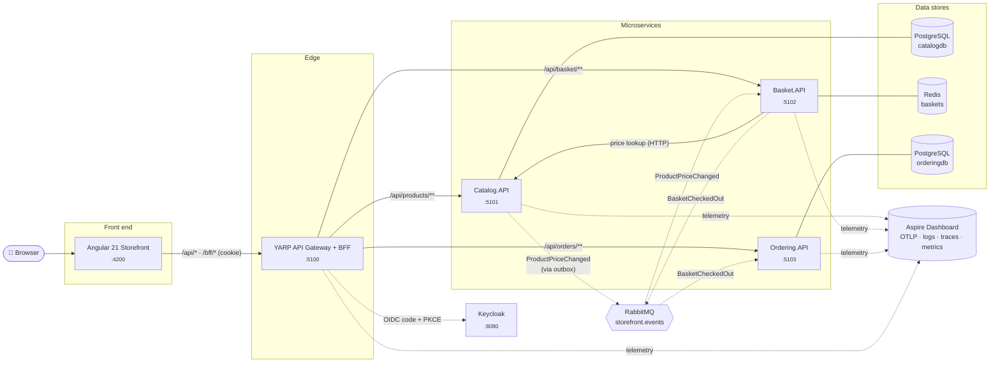
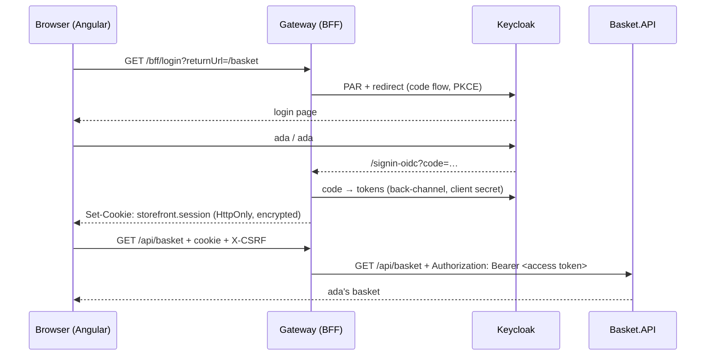

<div align="center">

# 🛒 ASP.NET Core Microservices

**A cloud-native e-commerce reference app built with .NET 10, YARP, .NET Aspire 13 and Angular 21.**

[](https://github.com/dejanciev-dev/aspnetcore-microservices/actions/workflows/ci.yml)


[](LICENSE)

</div>

---

## 📖 Overview

This repository is a small but complete **microservices storefront**. You browse a product catalog, fill a basket, check out and see your order history. Each step is handled by an independent service behind an API gateway.

The goal is to show **current, production-minded practices** for .NET and Angular. The domain is kept small so the architecture stays easy to read:

- **Small, independent services**, each owning its data store and HTTP contract (*database per service*)
- **Polyglot persistence**: PostgreSQL + EF Core 10 for catalog and orders, Redis for baskets
- **Event-driven integration over RabbitMQ**: a transactional outbox, idempotent consumers, dead-letter queues and asynchronous checkout
- **A single entry point** (YARP reverse proxy), so the browser only talks to one origin
- **Authentication with Keycloak using the BFF pattern**: OIDC + PKCE in the gateway, no tokens in the browser, JWT validation and role-based authorization in every service
- **Rate limiting at the edge**: per-user and per-IP token buckets, plus stricter policies for checkout and sign-in
- **Output caching at the edge**: catalog reads are served by the gateway and evicted when an admin changes a product
- **Resilient service-to-service calls** with retries, circuit breakers and timeouts
- **Observability built in**: logs, metrics and distributed traces through OpenTelemetry
- **Five ways to run it**: plain `dotnet run`, .NET Aspire, Docker Compose, Kubernetes (Kustomize, verified on kind in CI) or Azure Container Apps (`azd up`)
- **A modern Angular front end** that is zoneless, signal-based and uses `httpResource` and Signal Forms
- **Automated quality gates**: integration tests, component tests and GitHub Actions CI

> **Infrastructure fallback:** a service uses its database or RabbitMQ only when a connection string is configured, which Aspire and Docker Compose do automatically. Without one (plain `dotnet run`, the fast test suite) it falls back to an in-memory store and synchronous HTTP. Signing in always needs Keycloak, which is a single container (`docker compose up -d keycloak`).

## 🏗️ Architecture



| Component | Responsibility | Highlights |
|---|---|---|
| **Catalog.API** | Products, categories, search and paging | **PostgreSQL** via EF Core 10; migrations, seeding, `ILIKE` search; publishes `ProductPriceChanged` through a **transactional outbox** |
| **Basket.API** | Per-user shopping cart and checkout | **Redis** with a sliding 30-day expiry; **never trusts client prices**; reprices carts on events; **asynchronous checkout** |
| **Ordering.API** | Order creation and history | **PostgreSQL** via EF Core 10; creates orders from `BasketCheckedOut` **idempotently** |
| **ApiGateway** | Single public entry point and **BFF** | YARP reverse proxy; OIDC sign-in with Keycloak, HttpOnly session cookie, token refresh and relay, CSRF check, **rate limiting**, **output caching** |
| **BuildingBlocks.Common** | Shared cross-cutting concerns | OpenAPI + Scalar, ProblemDetails, health checks, resilience, OpenTelemetry, Keycloak JWT validation |
| **BuildingBlocks.Messaging** | Integration events | RabbitMQ.Client 7 publisher (confirms) and consumer host (retries, DLQ), EF Core outbox + relay, trace propagation |
| **AppHost** | Local orchestration | .NET Aspire 13: starts everything, wires URLs, hosts the dashboard |
| **Storefront** | Customer-facing SPA | Angular 21, zoneless, signals, `httpResource`, Signal Forms |

➡️ Design decisions, request flows and trade-offs are covered in **[docs/architecture.md](docs/architecture.md)**.

## 🧰 Tech stack

| Area | Technology |
|---|---|
| **Runtime** | .NET 10 (LTS), C# 14 |
| **APIs** | ASP.NET Core Minimal APIs, `TypedResults`, built-in validation (`AddValidation`), ProblemDetails (RFC 9457) |
| **API docs** | `Microsoft.AspNetCore.OpenApi` + [Scalar](https://scalar.com/) UI |
| **Data** | PostgreSQL 18 + EF Core 10 (Npgsql), Redis 8 (StackExchange.Redis), Aspire client integrations |
| **Messaging** | RabbitMQ 4 with RabbitMQ.Client 7 (async API), transactional outbox, Aspire RabbitMQ integration |
| **Identity** | Keycloak 26 (realm as code), OpenID Connect + PKCE, BFF pattern, JWT bearer with audience and role checks |
| **Gateway** | [YARP](https://microsoft.github.io/reverse-proxy/) 2.3 |
| **Resilience** | `Microsoft.Extensions.Http.Resilience` (Polly v8 standard pipeline) |
| **Observability** | OpenTelemetry (ASP.NET Core, HttpClient and runtime instrumentation), OTLP exporter |
| **Orchestration** | .NET Aspire 13 AppHost, Aspire Dashboard |
| **Front end** | Angular 21, TypeScript 5.9, standalone components, signals, `httpResource`, Signal Forms, SCSS |
| **Testing** | xUnit v3 on Microsoft.Testing.Platform, `WebApplicationFactory`, **Testcontainers** (real PostgreSQL and Redis), **Pact** contract tests, **Playwright** end-to-end tests, Vitest + Angular TestBed |
| **Containers** | Multi-stage Dockerfiles, **chiseled** (distroless, non-root) .NET images, nginx |
| **CI** | GitHub Actions: build, test and coverage for .NET and Angular, plus Docker image builds |

## 🚀 Quick start

### Prerequisites

| Tool | Version | Needed for |
|---|---|---|
| [.NET SDK](https://dotnet.microsoft.com/download/dotnet/10.0) | 10.0.100+ | everything (pinned in [`global.json`](global.json)) |
| [Node.js](https://nodejs.org/) | 22 LTS | the Angular storefront |
| [Docker](https://www.docker.com/) | yes | Keycloak (sign-in); PostgreSQL, Redis and RabbitMQ (Aspire or Compose); the integration tests |

```bash
git clone https://github.com/dejanciev-dev/aspnetcore-microservices.git
cd aspnetcore-microservices
cd src/Web/storefront && npm install && cd ../../..
```

### Option 1: .NET Aspire (recommended)

```bash
dotnet run --project src/Aspire/AppHost
```

One command starts **Keycloak, PostgreSQL, Redis and RabbitMQ containers**, all three services, the gateway and the Angular dev server. It wires connection strings and URLs together and opens the **Aspire dashboard**, which shows live logs, metrics and **distributed traces**. A single trace follows a checkout from the gateway through Basket, across RabbitMQ and into Ordering's database insert.

### Option 2: run each project yourself (in-memory stores, HTTP checkout)

```bash
docker compose up -d keycloak          # the only container this mode needs

# four terminals (or use your IDE's multi-project launch)
dotnet run --project src/Services/Catalog/Catalog.API
dotnet run --project src/Services/Basket/Basket.API
dotnet run --project src/Services/Ordering/Ordering.API
dotnet run --project src/ApiGateways/ApiGateway

# fifth terminal
cd src/Web/storefront && npm start
```

### Option 3: Docker Compose (everything, including PostgreSQL, Redis and RabbitMQ)

```bash
docker compose up --build
```

On first start, Catalog and Ordering apply their EF Core migrations and Catalog seeds its products. Data lives in named volumes, so it survives `docker compose down` (use `down -v` to reset).

### Option 4: Kubernetes or Azure Container Apps

```bash
kubectl apply -k deploy/k8s/overlays/kind   # a local kind cluster, same URLs as Compose
azd up                                      # Azure Container Apps, PostgreSQL Flexible Server, ACR
```

➡️ Details: [docs/deployment.md](docs/deployment.md).

### Sign in

The realm is imported automatically with two demo users:

| User | Password | Roles | Can |
|---|---|---|---|
| `ada` | `ada` | `admin`, `customer` | shop, and change product prices on the product page |
| `grace` | `grace` | `customer` | shop |

New accounts can also be registered from the Keycloak login page.

### Where to go

| URL | What |
|---|---|
| http://localhost:4200 | 🛍️ Storefront (Angular) |
| http://localhost:5100 | 🚪 API gateway (BFF) |
| http://localhost:8080 | 🔐 Keycloak; admin console `admin` / `admin` |
| http://localhost:5101/scalar | 📘 Catalog API docs (Scalar) |
| http://localhost:5102/scalar | 📘 Basket API docs |
| http://localhost:5103/scalar | 📘 Ordering API docs |
| http://localhost:18888 | 📈 Aspire dashboard (Docker Compose) |
| `localhost:5432` / `localhost:6379` | 🐘 PostgreSQL / 🟥 Redis (Docker Compose) |
| http://localhost:15672 | 🐇 RabbitMQ management UI, `storefront` / `storefront` (Docker Compose) |

➡️ Detailed setup, configuration and troubleshooting: **[docs/getting-started.md](docs/getting-started.md)**.

## 🔌 API at a glance

All routes are reachable through the gateway at `http://localhost:5100`. The user always comes from the access token, never from the URL.

| Method | Route | Access | Description |
|---|---|---|---|
| `GET` | `/api/products?category=&search=&page=&pageSize=` | public | Paged and filtered product list |
| `GET` | `/api/products/categories` | public | Distinct categories |
| `GET` | `/api/products/{id}` | public | Product details |
| `POST` / `PUT` / `DELETE` | `/api/products[/{id}]` | `admin` | Manage products |
| `GET` | `/api/basket` | signed in | Your basket |
| `POST` | `/api/basket/items` | signed in | Add an item (price is looked up in Catalog) |
| `DELETE` | `/api/basket/items/{productId}` | signed in | Remove an item |
| `POST` | `/api/basket/checkout` | signed in | Turn the basket into an order (via RabbitMQ when available) |
| `GET` | `/api/orders` | signed in | Your orders, newest first |
| `GET` | `/api/orders/{id}` | owner or `admin` | Order details |

```bash
# API clients authenticate with a bearer token (the browser uses the BFF session cookie instead)
TOKEN=$(curl -s http://localhost:8080/realms/storefront/protocol/openid-connect/token \
  -d grant_type=password -d client_id=storefront-tests -d username=ada -d password=ada | jq -r .access_token)

# add a 4K monitor to ada's basket, then check out
curl -X POST http://localhost:5100/api/basket/items -H "Authorization: Bearer $TOKEN" \
     -H "Content-Type: application/json" \
     -d '{"productId":"4f1c9a0e-0001-4a6e-9b1a-000000000003","quantity":1}'

curl -X POST http://localhost:5100/api/basket/checkout -H "Authorization: Bearer $TOKEN" \
     -H "Content-Type: application/json" \
     -d '{"shippingAddress":{"fullName":"Ada Lovelace","street":"1 Main St","city":"London","country":"UK","zipCode":"N1 9GU"}}'
```

➡️ Full reference with request and response examples: **[docs/api-reference.md](docs/api-reference.md)**.

## 🔐 Security



- **BFF pattern** (as recommended by *OAuth 2.0 for Browser-Based Applications*): tokens never reach JavaScript. The gateway is a confidential OIDC client using the authorization code flow with **PKCE** and **PAR**, and stores tokens in an encrypted, **HttpOnly, SameSite=Lax** cookie.
- **Token lifecycle:** access tokens live 5 minutes; the gateway refreshes them shortly before expiry, and ends the session if refresh fails.
- **CSRF:** cookie-authenticated `/api` calls must carry an `X-CSRF` header, which cross-site forms can't add.
- **APIs validate every request themselves** (defense in depth): Keycloak signature and issuer, the `storefront-api` **audience**, and Keycloak realm roles mapped to .NET roles.
- **Authorization:** catalog writes need the `admin` role; baskets and orders belong to the user in the token. Other users' orders return `404`, so IDs can't be probed.
- **Token relay:** Basket forwards the caller's token when it calls Ordering over HTTP.
- **Rate limiting:** the gateway gives each signed-in user, or each anonymous IP, a token bucket (bursts are fine, floods are not). Checkout and sign-in have stricter limits. Excess requests get `429` with `Retry-After`.
- **Realm as code:** [`deploy/keycloak/storefront-realm.json`](deploy/keycloak/storefront-realm.json) defines clients, roles and demo users. Aspire, Compose and the tests all import it. Its secrets are for local development only.

➡️ Details: [docs/architecture.md](docs/architecture.md#security).

## 📨 Messaging

| Event | Publisher | Consumer | Purpose |
|---|---|---|---|
| `catalog.product-price-changed` | Catalog (**transactional outbox**) | Basket | Reprice carts that hold the product |
| `basket.checked-out` | Basket | Ordering | Create the order **asynchronously and idempotently** |

- **Transactional outbox:** Catalog writes the price change and the event in **one PostgreSQL transaction**. A background relay publishes pending rows, claiming them with `FOR UPDATE SKIP LOCKED` so several replicas can share the work. An event can never be lost, nor sent for a rolled-back change.
- **Asynchronous checkout:** Basket publishes `BasketCheckedOut` with a **pre-generated order ID** (after the broker confirms) and answers immediately. Ordering creates the order when it receives the message; redelivered messages map to the same ID and are ignored. Checkout keeps working while Ordering is down.
- **Reliability:** durable queues, persistent messages, publisher confirms, manual acks, in-process retries, then a **dead-letter queue** per subscription.
- **Observability:** W3C trace context travels in message headers, so producer and consumer spans join the same distributed trace.
- **Without a broker** (plain `dotnet run`), checkout falls back to the synchronous HTTP call and no events are published.

➡️ Details and sequence diagrams: [docs/architecture.md](docs/architecture.md#messaging).

## 🖥️ Front end

The storefront in [`src/Web/storefront`](src/Web/storefront) uses the latest Angular features:

- **Zoneless change detection**: no zone.js, rendering driven entirely by signals
- **No OIDC library needed**: thanks to the BFF, the app just asks `/bff/user` who is signed in; a route guard and an HTTP interceptor (CSRF header, expired sessions) do the rest
- **`httpResource`**: declarative, reactive data loading that refetches when its inputs (route params, user) change
- **Signal Forms** (`@angular/forms/signals`) for the checkout form, with schema-based validation
- **Router input binding**: query and route params arrive as component `input()`s
- **Lazy-loaded routes**, view transitions, new control flow (`@if`, `@for`, `@let`)
- A small **signal-based store** for the basket, with no state library needed
- Light and dark themes, responsive layout, skeleton loaders and toasts

➡️ More in **[docs/frontend.md](docs/frontend.md)** and the [storefront README](src/Web/storefront/README.md).

## 🧪 Testing

```bash
dotnet test                                          # 31 API + 9 contract + 18 container-backed tests (xUnit v3)
cd src/Web/storefront && npx ng test --watch=false   # 17 unit/component tests (Vitest)
cd tests/e2e && npm ci && npx playwright test        # 13 browser tests + 2 sign-in setups (Playwright)
```

- **API tests** (`tests/Services.Tests`): each service is booted with `WebApplicationFactory` on its in-memory store. A test authentication handler stands in for Keycloak, which keeps authorization rules (401, 403, per-user isolation) fast to test. Downstream services are replaced by fakes. Gateway tests cover the BFF endpoints, the CSRF check, rate limiting and output caching.
- **Contract tests** (`tests/Services.ContractTests`): consumer-driven contracts with **Pact**. Basket records what it needs from Catalog (product lookup, 404), Ordering (create order with the relayed token) and the `catalog.product-price-changed` event; Ordering records what it needs in `basket.checked-out`. Each side runs its real client or handler, and the providers verify the committed pact files against the real services. Renaming a field one side relies on fails the build, even though each service keeps its own copy of the types.
- **Integration tests** (`tests/Services.IntegrationTests`): **Testcontainers** starts real PostgreSQL 18, Redis 8 and RabbitMQ 4 containers. The tests cover migrations and seeding, `ILIKE` search, persistence across restarts and Redis expiry. They also run **end-to-end messaging flows across two live services**: a price change repricing a basket via the outbox, checkout creating an order via RabbitMQ, and a duplicate message producing exactly one order. **Keycloak** tests validate real tokens (signature, audience, role mapping) and drive a **full browser-style BFF sign-in** through the real login page, down to the access token the gateway relays. Without Docker they are skipped locally; in CI they must run.
- **Front end:** stores and components are tested with `HttpTestingController`, covering request shapes, rendering, validation and error states.
- **End-to-end tests** (`tests/e2e`): **Playwright** drives Chromium through the whole system started with Docker Compose. It signs in on the real Keycloak page, browses and filters the catalog, fills a basket, places an order that travels through RabbitMQ to Ordering, and signs out. An admin changes a price and watches it reach an open basket via the outbox. The signed-out catalog tests also run against `dotnet run` + `ng serve`, without Docker.
- **CI** runs both suites and builds every Docker image on each push and pull request.

## 📁 Project structure

```text
aspnetcore-microservices/
├── src/
│   ├── ApiGateways/ApiGateway/          # YARP reverse proxy
│   ├── Aspire/AppHost/                  # .NET Aspire orchestration
│   ├── BuildingBlocks/
│   │   ├── BuildingBlocks.Common/       # shared service defaults
│   │   └── BuildingBlocks.Messaging/    # RabbitMQ publisher/consumer, outbox
│   ├── Services/
│   │   ├── Catalog/Catalog.API/         # products
│   │   ├── Basket/Basket.API/           # carts & checkout
│   │   └── Ordering/Ordering.API/       # orders
│   ├── Web/storefront/                  # Angular 21 SPA
│   └── Dockerfile                       # shared image for all .NET services
├── tests/
│   ├── Services.Tests/                  # API tests (in-memory, fast)
│   ├── Services.ContractTests/          # Pact contracts: Basket ↔ Catalog, Ordering (HTTP + events)
│   ├── e2e/                             # Playwright browser tests against the running stack
│   └── Services.IntegrationTests/       # PostgreSQL, Redis, RabbitMQ, Keycloak via Testcontainers
├── deploy/
│   ├── keycloak/                        # Keycloak realm (clients, roles, demo users) + Azure image
│   └── k8s/                             # Kustomize base + kind overlay
├── infra/                               # Bicep for Azure Container Apps (azd)
├── azure.yaml                           # azd services
├── docs/                                # architecture, API, front end, setup
├── docker-compose.yml
├── global.json                          # SDK pin + Microsoft.Testing.Platform opt-in
├── dotnet-tools.json                    # local tools (dotnet-ef)
└── aspnetcore-microservices.slnx        # new XML solution format
```

Each service follows the same layout: `Program.cs` (composition root), `Endpoints/` (minimal API route groups), `Models/` (records and contracts) and `Data/` (repository interface, in-memory and database implementations, `DbContext` and `Migrations/`).

## 🗺️ Roadmap

- [x] Real persistence: PostgreSQL + EF Core (Catalog, Ordering), Redis (Basket), provisioned by Aspire and Compose
- [x] Asynchronous messaging over RabbitMQ with a transactional outbox and idempotent consumers
- [x] Authentication with Keycloak (OIDC, BFF pattern), replacing the demo user name
- [x] Rate limiting at the gateway
- [x] Output caching at the gateway (catalog reads)
- [x] Contract tests between Basket and its downstream services (Pact, HTTP and events)
- [x] Playwright end-to-end tests
- [x] Kubernetes manifests (Kustomize), deployed to kind and tested end to end in CI
- [x] Azure Container Apps deployment via `azd` (Bicep; built and linted in CI, not deployed by it)

## 📚 Documentation

| Document | Contents |
|---|---|
| [Getting started](docs/getting-started.md) | Setup, run modes, configuration, troubleshooting |
| [Deployment](docs/deployment.md) | Kubernetes (Kustomize, kind) and Azure Container Apps (azd, Bicep) |
| [Architecture](docs/architecture.md) | Services, communication, design decisions, observability |
| [API reference](docs/api-reference.md) | Every endpoint with examples and error formats |
| [Front end](docs/frontend.md) | Angular structure, state, data loading, forms, testing |

## 📄 License

Released under the [MIT License](LICENSE).
