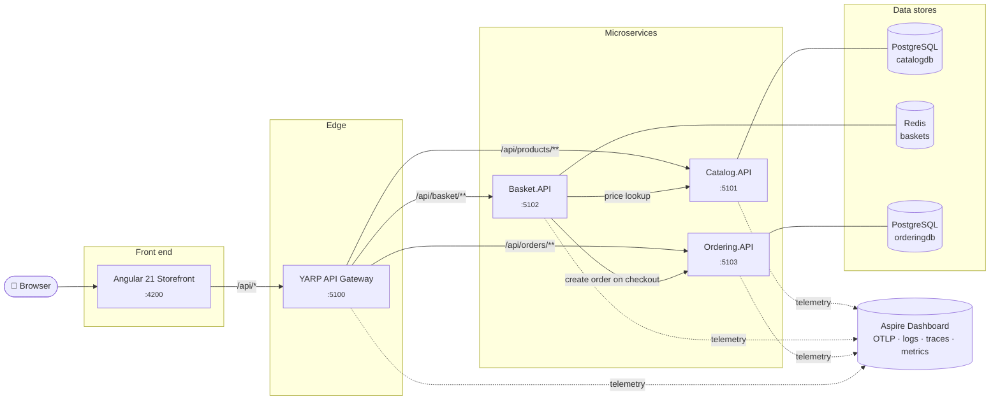

<div align="center">

# 🛒 ASP.NET Core Microservices

**A cloud-native e-commerce reference app built with .NET 10, YARP, .NET Aspire 13 and Angular 21.**

[](https://github.com/dejanciev-dev/aspnetcore-microservices/actions/workflows/ci.yml)


[](LICENSE)

</div>

---

## 📖 Overview

This repository is a small but complete **microservices storefront**. You browse a product catalog, fill a basket, check out and see your order history. Each step is handled by an independent service behind an API gateway.

The goal is to show **current, production-minded practices** for .NET and Angular. The domain is kept small so the architecture stays easy to read:

- **Small, independent services**, each owning its data store and HTTP contract (*database per service*)
- **Polyglot persistence**: PostgreSQL + EF Core 10 for catalog and orders, Redis for baskets
- **A single entry point** (YARP reverse proxy), so the browser only talks to one origin
- **Resilient service-to-service calls** with retries, circuit breakers and timeouts
- **Observability built in**: logs, metrics and distributed traces through OpenTelemetry
- **Three ways to run it**: plain `dotnet run`, .NET Aspire, or Docker Compose
- **A modern Angular front end** that is zoneless, signal-based and uses `httpResource` and Signal Forms
- **Automated quality gates**: integration tests, component tests and GitHub Actions CI

> **Zero-infrastructure fallback:** a service uses its database only when a connection string is configured, which Aspire and Docker Compose do automatically. Without one (plain `dotnet run`, the fast test suite) it falls back to an in-memory store, so you can still clone and run the whole system in seconds without Docker.

## 🏗️ Architecture



| Component | Responsibility | Highlights |
|---|---|---|
| **Catalog.API** | Products, categories, search and paging | **PostgreSQL** via EF Core 10; migrations, seeding, `ILIKE` search, `ExecuteUpdate`/`ExecuteDelete` |
| **Basket.API** | Per-user shopping cart and checkout | **Redis** with a sliding 30-day expiry; typed `HttpClient`s; **never trusts client prices** |
| **Ordering.API** | Order creation and history | **PostgreSQL** via EF Core 10; persistence model separate from API records; `TimeProvider` |
| **ApiGateway** | Single public entry point | YARP reverse proxy, config-driven routes |
| **BuildingBlocks.Common** | Shared cross-cutting concerns | OpenAPI + Scalar, ProblemDetails, health checks, resilience, OpenTelemetry |
| **AppHost** | Local orchestration | .NET Aspire 13: starts everything, wires URLs, hosts the dashboard |
| **Storefront** | Customer-facing SPA | Angular 21, zoneless, signals, `httpResource`, Signal Forms |

➡️ Design decisions, request flows and trade-offs are covered in **[docs/architecture.md](docs/architecture.md)**.

## 🧰 Tech stack

| Area | Technology |
|---|---|
| **Runtime** | .NET 10 (LTS), C# 14 |
| **APIs** | ASP.NET Core Minimal APIs, `TypedResults`, built-in validation (`AddValidation`), ProblemDetails (RFC 9457) |
| **API docs** | `Microsoft.AspNetCore.OpenApi` + [Scalar](https://scalar.com/) UI |
| **Data** | PostgreSQL 18 + EF Core 10 (Npgsql), Redis 8 (StackExchange.Redis), Aspire client integrations |
| **Gateway** | [YARP](https://microsoft.github.io/reverse-proxy/) 2.3 |
| **Resilience** | `Microsoft.Extensions.Http.Resilience` (Polly v8 standard pipeline) |
| **Observability** | OpenTelemetry (ASP.NET Core, HttpClient and runtime instrumentation), OTLP exporter |
| **Orchestration** | .NET Aspire 13 AppHost, Aspire Dashboard |
| **Front end** | Angular 21, TypeScript 5.9, standalone components, signals, `httpResource`, Signal Forms, SCSS |
| **Testing** | xUnit v3 on Microsoft.Testing.Platform, `WebApplicationFactory`, **Testcontainers** (real PostgreSQL and Redis), Vitest + Angular TestBed |
| **Containers** | Multi-stage Dockerfiles, **chiseled** (distroless, non-root) .NET images, nginx |
| **CI** | GitHub Actions: build, test and coverage for .NET and Angular, plus Docker image builds |

## 🚀 Quick start

### Prerequisites

| Tool | Version | Needed for |
|---|---|---|
| [.NET SDK](https://dotnet.microsoft.com/download/dotnet/10.0) | 10.0.100+ | everything (pinned in [`global.json`](global.json)) |
| [Node.js](https://nodejs.org/) | 22 LTS | the Angular storefront |
| [Docker](https://www.docker.com/) | recommended | PostgreSQL and Redis (Aspire or Compose) and the integration tests |

```bash
git clone https://github.com/dejanciev-dev/aspnetcore-microservices.git
cd aspnetcore-microservices
cd src/Web/storefront && npm install && cd ../../..
```

### Option 1: .NET Aspire (recommended)

```bash
dotnet run --project src/Aspire/AppHost
```

One command starts **PostgreSQL and Redis containers**, all three services, the gateway and the Angular dev server. It wires connection strings and URLs together and opens the **Aspire dashboard**, which shows live logs, metrics and **distributed traces** of a checkout flowing Gateway → Basket → Redis/Catalog/Ordering → PostgreSQL.

### Option 2: run each project yourself (no Docker, in-memory stores)

```bash
# four terminals (or use your IDE's multi-project launch)
dotnet run --project src/Services/Catalog/Catalog.API
dotnet run --project src/Services/Basket/Basket.API
dotnet run --project src/Services/Ordering/Ordering.API
dotnet run --project src/ApiGateways/ApiGateway

# fifth terminal
cd src/Web/storefront && npm start
```

### Option 3: Docker Compose (everything, including PostgreSQL and Redis)

```bash
docker compose up --build
```

On first start, Catalog and Ordering apply their EF Core migrations and Catalog seeds its products. Data lives in named volumes, so it survives `docker compose down` (use `down -v` to reset).

### Where to go

| URL | What |
|---|---|
| http://localhost:4200 | 🛍️ Storefront (Angular) |
| http://localhost:5100 | 🚪 API gateway |
| http://localhost:5101/scalar | 📘 Catalog API docs (Scalar) |
| http://localhost:5102/scalar | 📘 Basket API docs |
| http://localhost:5103/scalar | 📘 Ordering API docs |
| http://localhost:18888 | 📈 Aspire dashboard (Docker Compose) |
| `localhost:5432` / `localhost:6379` | 🐘 PostgreSQL / 🟥 Redis (Docker Compose) |

➡️ Detailed setup, configuration and troubleshooting: **[docs/getting-started.md](docs/getting-started.md)**.

## 🔌 API at a glance

All routes are reachable through the gateway at `http://localhost:5100`.

| Method | Route | Description |
|---|---|---|
| `GET` | `/api/products?category=&search=&page=&pageSize=` | Paged and filtered product list |
| `GET` | `/api/products/categories` | Distinct categories |
| `GET` | `/api/products/{id}` | Product details |
| `POST` / `PUT` / `DELETE` | `/api/products[/{id}]` | Manage products |
| `GET` | `/api/basket/{userName}` | Current basket |
| `POST` | `/api/basket/{userName}/items` | Add an item (price is looked up in Catalog) |
| `DELETE` | `/api/basket/{userName}/items/{productId}` | Remove an item |
| `POST` | `/api/basket/{userName}/checkout` | Turn the basket into an order |
| `GET` | `/api/orders?userName=` | A user's orders, newest first |
| `GET` | `/api/orders/{id}` | Order details |

```bash
# add a 4K monitor to ada's basket, then check out
curl -X POST http://localhost:5100/api/basket/ada/items \
     -H "Content-Type: application/json" \
     -d '{"productId":"4f1c9a0e-0001-4a6e-9b1a-000000000003","quantity":1}'

curl -X POST http://localhost:5100/api/basket/ada/checkout \
     -H "Content-Type: application/json" \
     -d '{"shippingAddress":{"fullName":"Ada Lovelace","street":"1 Main St","city":"London","country":"UK","zipCode":"N1 9GU"}}'
```

➡️ Full reference with request and response examples: **[docs/api-reference.md](docs/api-reference.md)**.

## 🖥️ Front end

The storefront in [`src/Web/storefront`](src/Web/storefront) uses the latest Angular features:

- **Zoneless change detection**: no zone.js, rendering driven entirely by signals
- **`httpResource`**: declarative, reactive data loading that refetches when its inputs (route params, user) change
- **Signal Forms** (`@angular/forms/signals`) for the checkout form, with schema-based validation
- **Router input binding**: query and route params arrive as component `input()`s
- **Lazy-loaded routes**, view transitions, new control flow (`@if`, `@for`, `@let`)
- A small **signal-based store** for the basket, with no state library needed
- Light and dark themes, responsive layout, skeleton loaders and toasts

➡️ More in **[docs/frontend.md](docs/frontend.md)** and the [storefront README](src/Web/storefront/README.md).

## 🧪 Testing

```bash
dotnet test                                          # 11 API tests + 9 database tests (xUnit v3)
cd src/Web/storefront && npx ng test --watch=false   # 9 unit/component tests (Vitest)
```

- **API tests** (`tests/Services.Tests`): each service is booted with `WebApplicationFactory` on its in-memory store. Downstream services are replaced by fakes, so Basket is tested without Catalog or Ordering running.
- **Database tests** (`tests/Services.IntegrationTests`): **Testcontainers** starts real PostgreSQL 18 and Redis 8 containers. The tests cover migrations and seeding, `ILIKE` search, persistence across app restarts and Redis expiry. Without Docker they are skipped locally; in CI they must run.
- **Front end:** stores and components are tested with `HttpTestingController`, covering request shapes, rendering, validation and error states.
- **CI** runs both suites and builds every Docker image on each push and pull request.

## 📁 Project structure

```text
aspnetcore-microservices/
├── src/
│   ├── ApiGateways/ApiGateway/          # YARP reverse proxy
│   ├── Aspire/AppHost/                  # .NET Aspire orchestration
│   ├── BuildingBlocks/BuildingBlocks.Common/  # shared service defaults
│   ├── Services/
│   │   ├── Catalog/Catalog.API/         # products
│   │   ├── Basket/Basket.API/           # carts & checkout
│   │   └── Ordering/Ordering.API/       # orders
│   ├── Web/storefront/                  # Angular 21 SPA
│   └── Dockerfile                       # shared image for all .NET services
├── tests/
│   ├── Services.Tests/                  # API tests (in-memory, fast)
│   └── Services.IntegrationTests/       # PostgreSQL + Redis via Testcontainers
├── docs/                                # architecture, API, front end, setup
├── docker-compose.yml
├── global.json                          # SDK pin + Microsoft.Testing.Platform opt-in
├── dotnet-tools.json                    # local tools (dotnet-ef)
└── aspnetcore-microservices.slnx        # new XML solution format
```

Each service follows the same layout: `Program.cs` (composition root), `Endpoints/` (minimal API route groups), `Models/` (records and contracts) and `Data/` (repository interface, in-memory and database implementations, `DbContext` and `Migrations/`).

## 🗺️ Roadmap

- [x] Real persistence: PostgreSQL + EF Core (Catalog, Ordering), Redis (Basket), provisioned by Aspire and Compose
- [ ] Asynchronous messaging (RabbitMQ / MassTransit) with an outbox, e.g. `OrderSubmitted` events
- [ ] Authentication with Keycloak / Entra ID (OIDC), replacing the demo user name
- [ ] Rate limiting and output caching at the gateway
- [ ] Contract tests between Basket and its downstream services
- [ ] Playwright end-to-end tests
- [ ] Kubernetes manifests / Azure Container Apps deployment via `azd`

## 📚 Documentation

| Document | Contents |
|---|---|
| [Getting started](docs/getting-started.md) | Setup, run modes, configuration, troubleshooting |
| [Architecture](docs/architecture.md) | Services, communication, design decisions, observability |
| [API reference](docs/api-reference.md) | Every endpoint with examples and error formats |
| [Front end](docs/frontend.md) | Angular structure, state, data loading, forms, testing |

## 📄 License

Released under the [MIT License](LICENSE).
