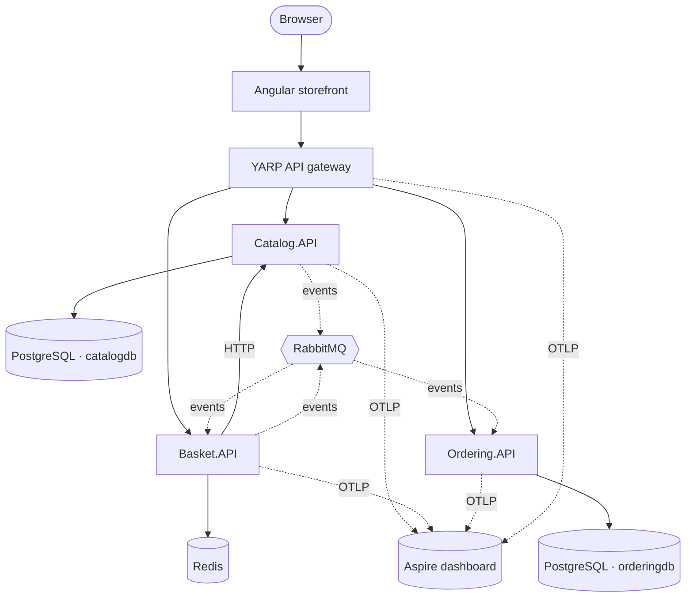
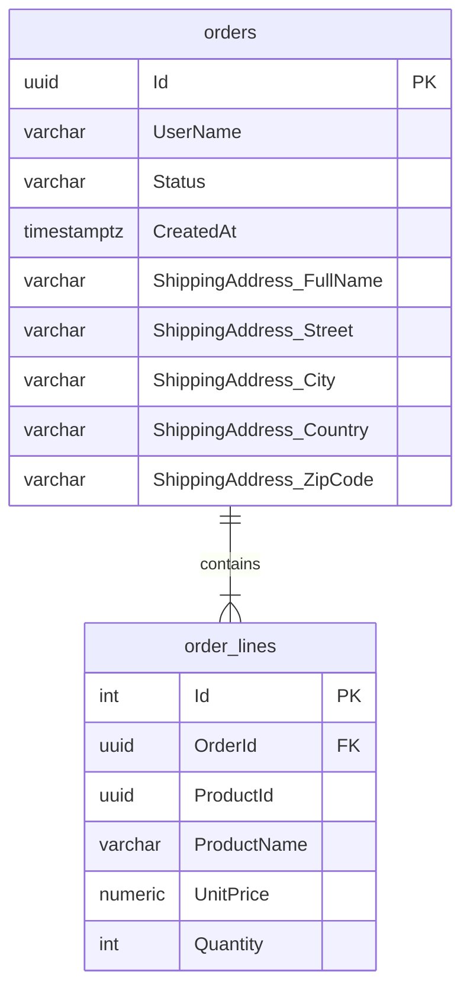
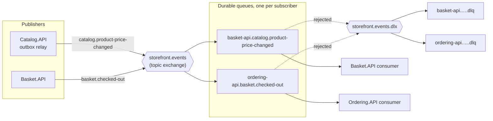
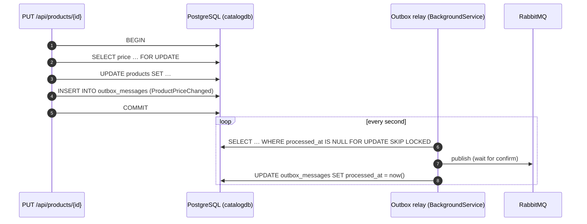
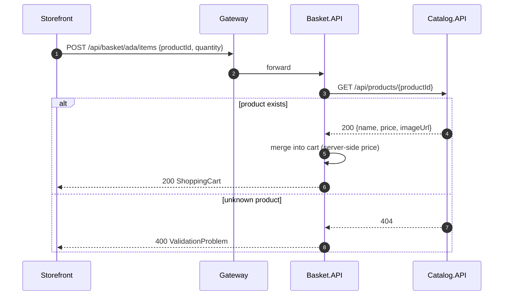
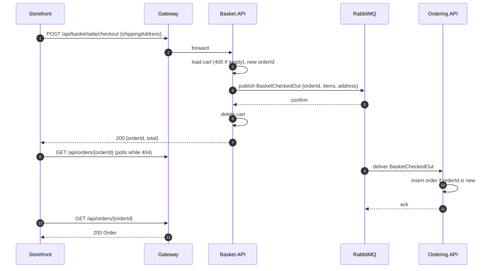

# Architecture

This document explains how the system is put together and why. For setup instructions see [getting-started.md](getting-started.md).

- [System context](#system-context)
- [Services](#services)
- [Communication](#communication)
- [Persistence](#persistence)
- [Messaging](#messaging)
- [Request flows](#request-flows)
- [Cross-cutting concerns](#cross-cutting-concerns)
- [Design decisions](#design-decisions)
- [Testing strategy](#testing-strategy)
- [Known limitations](#known-limitations)

---

## System context



The browser only ever talks to **one origin**. In development the Angular dev server proxies `/api` to the gateway; in containers nginx does the same. No service needs CORS, and the internal topology can change without touching the front end.

## Services

Every service is an ASP.NET Core **Minimal API** with the same internal layout:

```text
Service.API/
├── Program.cs        # composition root: AddServiceDefaults(), DI, MapDefaultEndpoints()
├── Endpoints/        # route groups (MapGroup) returning TypedResults
├── Models/           # immutable records: entities + request/response contracts
├── Data/             # repository interface, in-memory + database implementations,
│                     # DbContext and EF Core Migrations/ (Catalog, Ordering)
└── *ApiMarker.cs     # anchor type for WebApplicationFactory in tests
```

### Catalog.API

The source of truth for products and prices.

- **PostgreSQL** (`catalogdb`) through EF Core 10 + Npgsql
- Paged listing with category filter and free-text search (`PagedResult<T>` from BuildingBlocks); filtering, counting and paging all run in SQL
- Case-insensitive search with PostgreSQL `ILIKE`, escaping `%` and `_` so input is matched literally
- Updates and deletes use `ExecuteUpdateAsync` / `ExecuteDeleteAsync`: a single SQL statement, no load-then-save round trip
- Full CRUD with DataAnnotations validation on `UpsertProductRequest`
- Seeded with 8 products across 4 categories through EF Core's `UseAsyncSeeding`, which runs as part of `MigrateAsync()`

### Basket.API

A per-user shopping cart and the **orchestrator of checkout**.

- **Redis**: each cart is one JSON document under `basket:{user}` with a **sliding 30-day expiry** that every write renews, so abandoned carts clean themselves up
- The cart is keyed by user name; `ShoppingCart` and `CartItem` are immutable records updated with `with` expressions
- **Adding an item resolves the product from Catalog**, so a client can never set its own price
- **Checkout** sends the cart to Ordering, and clears the basket only after Ordering confirms
- Talks to other services through typed clients (`ICatalogClient`, `IOrderingClient`). That keeps HTTP details out of the endpoints and makes them easy to fake in tests

### Ordering.API

Owns orders and their lifecycle.

- **PostgreSQL** (`orderingdb`) through EF Core 10 + Npgsql
- The API's immutable `Order` record is **not** the EF entity; see [Persistence](#persistence)
- `OrderStatus` is serialized as a string (`JsonStringEnumConverter<T>`) and stored as a string column
- Uses `TimeProvider` instead of `DateTime.UtcNow`, so timestamps are deterministic in tests
- Writes a structured log entry for every order (`{OrderId}`, `{UserName}`, `{Total}`)

### ApiGateway

A [YARP](https://microsoft.github.io/reverse-proxy/) reverse proxy configured entirely from `appsettings.json`:

| Route | Cluster | Default destination |
|---|---|---|
| `/api/products/{**catch-all}` | `catalog` | `http://localhost:5101` |
| `/api/basket/{**catch-all}` | `basket` | `http://localhost:5102` |
| `/api/orders/{**catch-all}` | `ordering` | `http://localhost:5103` |

Destinations are overridden by environment variables under Aspire and Docker Compose. That is the only thing that differs between environments.

### BuildingBlocks.Common

A shared library that keeps every service consistent with two calls:

```csharp
builder.AddServiceDefaults();   // OpenAPI, ProblemDetails, health checks, resilience, OpenTelemetry
app.MapDefaultEndpoints();      // exception handler, /openapi, /scalar, /health
```

It deliberately holds **only cross-cutting infrastructure**, never domain types. Sharing domain models across services would couple their release cycles.

### AppHost (.NET Aspire)

Describes the whole system as code: which projects run, how they find each other and in what order they start. See [getting-started.md](getting-started.md#1-net-aspire-apphost).

## Communication

| From → To | Style | Why |
|---|---|---|
| Browser → Gateway | REST/JSON over HTTP | Simple, cacheable, debuggable |
| Gateway → Services | Reverse proxy | Path-based routing; services stay private |
| Basket → Catalog | Synchronous HTTP (query) | The price must be current when an item is added |
| Catalog → Basket | `ProductPriceChanged` event over RabbitMQ | Catalog shouldn't know who caches its prices; Basket reacts on its own schedule |
| Basket → Ordering | `BasketCheckedOut` event over RabbitMQ (HTTP fallback without a broker) | Checkout mustn't depend on Ordering being up; the order ID is generated up front |

All outgoing `HttpClient`s get the **standard resilience pipeline** from `Microsoft.Extensions.Http.Resilience`: rate limiter, total timeout, retry with exponential backoff and jitter, circuit breaker and per-attempt timeout. A brief Catalog hiccup becomes a retry, not a failed request.

## Persistence

Each service owns its data store, and no service reads another's database (*database per service*). The stores are chosen to fit their data:

| Service | Store | Why |
|---|---|---|
| Catalog | PostgreSQL `catalogdb` | Relational, queried by category and text, needs paging and consistency |
| Ordering | PostgreSQL `orderingdb` | Durable business records; orders and lines are naturally relational |
| Basket | Redis | Short-lived, per-user key-value data read and written on every click; expiry built in |

### Choosing the store at startup

```csharp
var usePostgres = builder.Configuration.GetConnectionString("catalogdb") is not null;
if (usePostgres)
{
    builder.AddNpgsqlDbContext<CatalogDbContext>("catalogdb", ...);   // Aspire client integration
    builder.Services.AddScoped<IProductRepository, EfProductRepository>();
}
else
{
    builder.Services.AddSingleton<IProductRepository, InMemoryProductRepository>();
}
```

Aspire (`WithReference(catalogDb)`) and Docker Compose set `ConnectionStrings__catalogdb`, so the real database is used. Plain `dotnet run` and the fast API tests set nothing and stay in memory. The endpoints only see `IProductRepository` and are unaware of the difference.

The Aspire client integrations (`Aspire.Npgsql.EntityFrameworkCore.PostgreSQL`, `Aspire.StackExchange.Redis`) add **DbContext pooling, transient-fault retries, health checks** (reported on `/health`) and **OpenTelemetry tracing** of every SQL command and Redis call.

### Schema and migrations

- The schema is defined in `OnModelCreating` (lengths, `numeric(18,2)` precision, indexes) and versioned as **EF Core migrations** in `Data/Migrations/`.
- Services apply pending migrations at startup with `Database.MigrateAsync()`. That is convenient for a demo; in production you would run them as a deployment step (`dotnet ef database update`, a migration bundle or an Aspire/Kubernetes job) so several replicas never race.
- An `IDesignTimeDbContextFactory` lets `dotnet ef` build each context without starting the app or reaching a database.

### Ordering's persistence model



The public `Order` / `OrderItem` / `ShippingAddress` records stay immutable and free of persistence concerns. EF works with internal `OrderEntity` / `OrderLineEntity` classes and maps to and from the records at the repository boundary. The shipping address is an EF **complex type**: a value object stored as columns on `orders`, with no table or key of its own. Order lines have their own identity key, so the same product may legitimately appear twice.

## Messaging

Integration events go through **RabbitMQ** using the official **RabbitMQ.Client 7** async API, wrapped in `BuildingBlocks.Messaging`. Like the databases, messaging switches on when `ConnectionStrings:rabbitmq` is set.

### Topology



- **One topic exchange**; the routing key is the event's stable name from `[EventName("…")]`.
- **Each subscribing service owns a durable queue** named `<service>.<event>`. Adding a new subscriber never affects existing ones, and a service that is down simply accumulates messages.
- **Dead-lettering:** each queue has an `x-dead-letter-exchange`. A message whose handler still fails after 3 in-process retries (200 ms, 1 s, 3 s), or that can't be deserialized, is rejected into `<queue>.dlq` for inspection instead of blocking the queue.
- **Events are owned per service.** Catalog, Basket and Ordering each declare their own copy of the records they publish or consume; only the JSON shape and the name must match. Services share no assembly with event types.

### Reliability guarantees

| Concern | How |
|---|---|
| Message survives a broker restart | Durable exchange and queues, `DeliveryMode = Persistent` |
| Publisher knows the broker has it | **Publisher confirms**: `PublishAsync` completes only after the broker's ack and throws on a nack |
| Event is never lost or sent for a rolled-back change | **Transactional outbox** (Catalog) |
| Consumer crash doesn't lose a message | Manual acks after the handler succeeds; unacked messages are redelivered |
| Redelivery doesn't duplicate side effects | **Idempotent consumers**: Ordering keys orders by the event's `OrderId`; repricing is naturally idempotent |
| One trace across services | W3C `traceparent` is injected into message headers on publish and extracted on consume (including from the outbox, which stores it) |

### Transactional outbox



Publishing directly after `SaveChanges` would fail in one of two ways: a crash in between loses the event, and publishing first could announce a change that then rolls back. The outbox makes the event part of the same atomic write. `FOR UPDATE SKIP LOCKED` lets several Catalog replicas run the relay without publishing the same row twice. Delivery is still *at-least-once* (a crash after publish but before marking the row re-sends it), which is why consumers are idempotent.

### Asynchronous checkout

Basket has no relational database, so instead of an outbox it relies on **publisher confirms**:

1. Generate the `OrderId`.
2. Publish `BasketCheckedOut` and wait for the broker's confirmation. If that fails, the request fails and the basket is untouched.
3. Delete the basket and return `{ orderId, total }`.

Ordering consumes the event and inserts the order **only if that ID doesn't exist yet**: an existence check plus a unique-key violation guard for concurrent deliveries. The storefront navigates to `/orders/{id}?placed=true` and shows a "processing" state, polling until the order appears (usually well under a second).

## Request flows

### Add to basket



### Checkout (with RabbitMQ)



Without a broker the same endpoint calls `POST /api/orders` on Ordering synchronously. The switch is a different `IOrderingClient` implementation registered at startup, so the endpoint code is identical in both modes.

Because OpenTelemetry propagates W3C trace context through the gateway, every `HttpClient` and every RabbitMQ message, these flows appear as **single end-to-end traces** in the Aspire dashboard.

## Cross-cutting concerns

| Concern | Implementation |
|---|---|
| **Validation** | .NET 10 built-in Minimal API validation (`AddValidation()`) on DataAnnotations; failures return `400 ValidationProblem` automatically |
| **Errors** | `AddProblemDetails()` + `UseExceptionHandler()` + `UseStatusCodePages()`: every error is RFC 9457 `application/problem+json` |
| **API docs** | `AddOpenApi()` generates the document at `/openapi/v1.json`; Scalar renders it at `/scalar` |
| **Health** | `/health` on every service and the gateway, used by Aspire `WithHttpHealthCheck` |
| **Resilience** | `ConfigureHttpClientDefaults(h => h.AddStandardResilienceHandler())` |
| **Logging** | `ILogger` with message templates; exported through OpenTelemetry |
| **Tracing and metrics** | OpenTelemetry instrumentation for ASP.NET Core (excluding `/health`), HttpClient and the .NET runtime |
| **Export** | OTLP, enabled only when `OTEL_EXPORTER_OTLP_ENDPOINT` is set (Aspire and Compose set it; tests don't) |
| **Container security** | Chiseled images: no shell, no package manager, non-root user |

## Design decisions

<details open>
<summary><b>Minimal APIs over controllers</b></summary>

Endpoints are small and explicit. `TypedResults` with `Results<T1, T2>` gives compile-time-checked responses and accurate OpenAPI metadata without attributes. Route groups (`MapGroup`) keep related endpoints together.
</details>

<details>
<summary><b>Records and immutability</b></summary>

Domain objects and contracts are `sealed record`s. Updates use `with` expressions (for example `cart with { Items = ... }`), which removes a class of shared-mutable-state bugs in concurrent in-memory stores.
</details>

<details>
<summary><b>Real databases, with an in-memory fallback</b></summary>

Endpoints depend only on `IProductRepository`, `IBasketRepository` and `IOrderRepository`. With a connection string they get PostgreSQL or Redis implementations; without one they get in-memory ones. The project stays clone-and-run (no Docker needed to try it), and the fast API tests stay fast, while the real stores are exercised by the Testcontainers suite.
</details>

<details>
<summary><b>EF Core for Postgres, plain StackExchange.Redis for baskets</b></summary>

Catalog and Ordering get EF Core's migrations, LINQ translation and change tracking. Basket uses Redis as what it is, a key-value store: one `GET` or `SET` per request with a TTL, so an ORM or `IDistributedCache` abstraction would add nothing.
</details>

<details>
<summary><b>The server owns prices</b></summary>

`AddItemRequest` carries only `productId` and `quantity`. Basket fetches the name and price from Catalog, which prevents price tampering from the client.
</details>

<details>
<summary><b>Asynchronous checkout with a client-generated order ID</b></summary>

The UI wants an order ID right away, which previously forced a synchronous call to Ordering. Generating the ID in Basket removes that coupling: Basket can answer as soon as the broker has the message, Ordering can be down or slow, and the ID doubles as the idempotency key. The cost is eventual consistency: the order shows up a moment later, which the UI handles with a short "processing" state.
</details>

<details>
<summary><b>RabbitMQ.Client instead of MassTransit</b></summary>

MassTransit v9 moved to a commercial license, and the open-source v8 line is nearing its end of support. The official client plus a building block of under 500 lines (publisher confirms, consumer host with retries and DLQ, outbox, tracing) keeps the project free of licensing questions, and every pattern stays visible in the source. A team that wants sagas, scheduling or transport abstraction would reasonably choose MassTransit, Wolverine or NServiceBus instead.
</details>

<details>
<summary><b>Outbox for Catalog, publisher confirms for Basket</b></summary>

An outbox needs a transactional store next to the business data. Catalog has PostgreSQL, so its events are written atomically with the change. Basket keeps carts in Redis, so it publishes directly and only deletes the cart after the broker confirms; a failure leaves the cart intact and the user can retry.
</details>

<details>
<summary><b>Each service owns its contracts</b></summary>

`ShippingAddress` exists in both Basket and Ordering. The duplication is deliberate: each service can evolve its contract independently, as long as the JSON stays compatible.
</details>

<details>
<summary><b>A gateway instead of direct calls from the browser</b></summary>

One origin means no CORS, a single place for future auth, rate limiting and caching, and freedom to split or merge services without front-end changes.
</details>

## Testing strategy

| Layer | Tooling | What is verified |
|---|---|---|
| Service API | xUnit v3, `WebApplicationFactory<TMarker>` (in-memory stores) | Real HTTP pipeline: routing, validation, status codes, JSON contracts |
| Service isolation | `ConfigureTestServices` with fake typed clients | Basket logic without running Catalog or Ordering |
| Persistence | Testcontainers (PostgreSQL 18, Redis 8) | Migrations and seeding, SQL filtering and paging, `ILIKE` escaping, data surviving an app restart, Redis TTL and case-insensitive keys |
| Messaging (end to end) | Testcontainers (RabbitMQ 4) with two live services per test | Catalog price change → outbox → relay → Basket reprices the Redis cart; Basket checkout → RabbitMQ → order in Ordering's PostgreSQL; a duplicated message creates one order; unchanged prices stage no event |
| Front-end state | Vitest, `HttpTestingController` | `BasketStore` URLs, payloads and state transitions |
| Front-end components | Angular TestBed | Rendering, query-param binding, form validation, error states |
| Containers | GitHub Actions `docker compose build` | Every image builds from a clean checkout |

## Known limitations

These are intentional simplifications for a demo:

- **No authentication.** The "user" is a name stored in the browser. Never ship this as is.
- **Migrations run at startup.** That is fine for one replica; with several, run migrations as a separate deployment step.
- **Basket updates are last-write-wins.** Two simultaneous "add item" requests for the same user can overwrite each other. Redis transactions (`WATCH`/`MULTI`) or a hash per basket would fix this.
- **In-memory fallback** (when no connection string is set) loses data on restart and must not be scaled out.
- **Basket publish-then-delete isn't atomic.** If Basket crashes after the broker confirms but before the cart is deleted, the order is still created; the cart just stays around until the user clears it.
- **No dead-letter tooling.** Failed messages land in `<queue>.dlq`, but replaying them means using the RabbitMQ management UI.
- **The outbox is never pruned.** Processed rows stay in `outbox_messages`; production would delete them after a retention period.
- **HTTP checkout fallback (no broker)** keeps the old trade-off: if Ordering's response is lost, a retry could create a second order.
- **Product deletion** does not affect existing baskets; they keep a snapshot of name and price.
