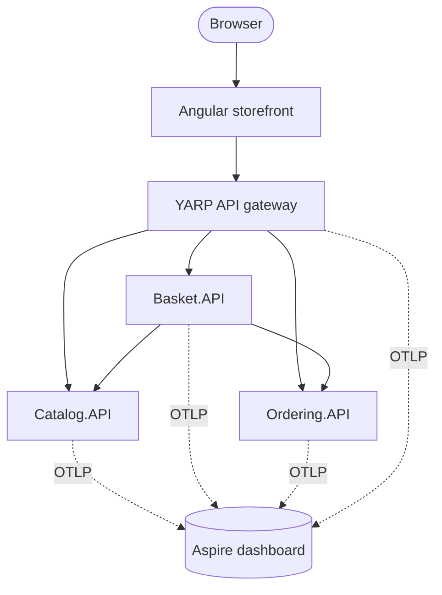
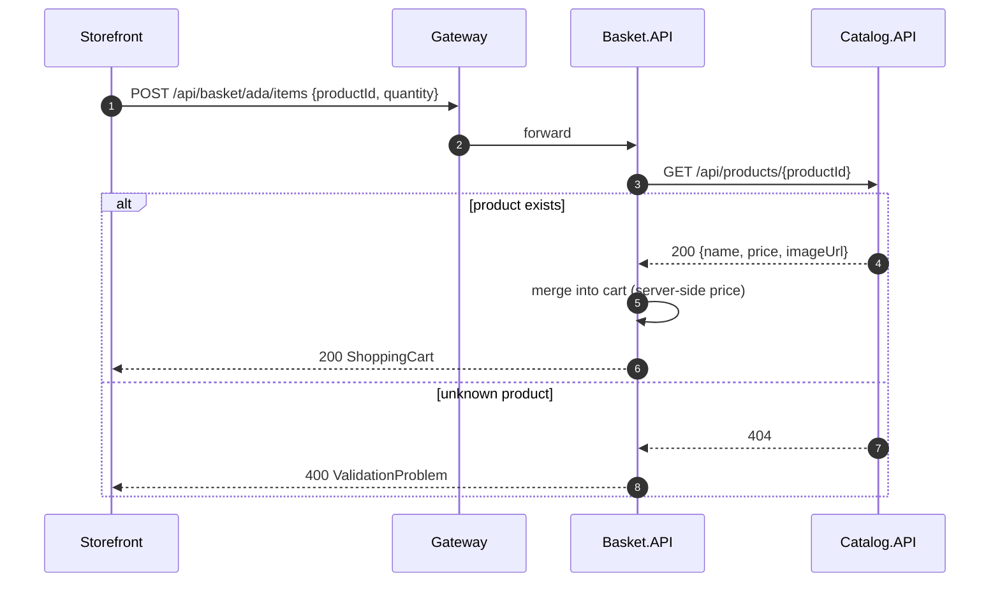
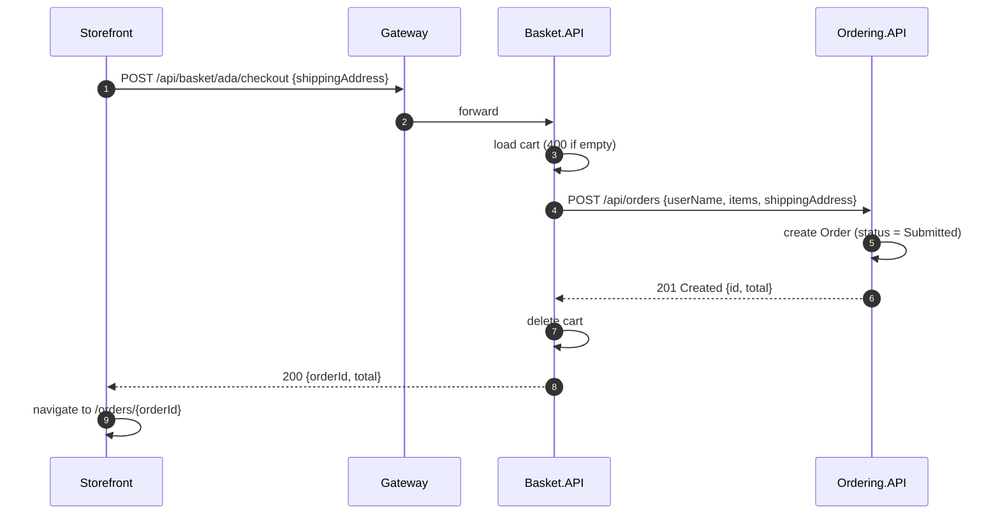

# Architecture

This document explains how the system is put together and why. For setup instructions see [getting-started.md](getting-started.md).

- [System context](#system-context)
- [Services](#services)
- [Communication](#communication)
- [Request flows](#request-flows)
- [Cross-cutting concerns](#cross-cutting-concerns)
- [Design decisions](#design-decisions)
- [Testing strategy](#testing-strategy)
- [Known limitations](#known-limitations)

---

## System context



The browser only ever talks to **one origin**. In development the Angular dev server proxies `/api` to the gateway; in containers nginx does the same. No service needs CORS, and the internal topology can change without touching the front end.

## Services

Every service is an ASP.NET Core **Minimal API** with the same internal layout:

```text
Service.API/
├── Program.cs        # composition root: AddServiceDefaults(), DI, MapDefaultEndpoints()
├── Endpoints/        # route groups (MapGroup) returning TypedResults
├── Models/           # immutable records: entities + request/response contracts
├── Data/             # repository interface + in-memory implementation
└── *ApiMarker.cs     # anchor type for WebApplicationFactory in tests
```

### Catalog.API

The source of truth for products and prices.

- Paged listing with category filter and free-text search (`PagedResult<T>` from BuildingBlocks)
- Full CRUD with DataAnnotations validation on `UpsertProductRequest`
- `CreatedAtRoute` responses for new resources
- Seeded with 8 products across 4 categories

### Basket.API

A per-user shopping cart and the **orchestrator of checkout**.

- The cart is keyed by user name; `ShoppingCart` and `CartItem` are immutable records updated with `with` expressions
- **Adding an item resolves the product from Catalog**, so a client can never set its own price
- **Checkout** sends the cart to Ordering, and clears the basket only after Ordering confirms
- Talks to other services through typed clients (`ICatalogClient`, `IOrderingClient`). That keeps HTTP details out of the endpoints and makes them easy to fake in tests

### Ordering.API

Owns orders and their lifecycle.

- `OrderStatus` is serialized as a string (`JsonStringEnumConverter<T>`)
- Uses `TimeProvider` instead of `DateTime.UtcNow`, so timestamps are deterministic in tests
- Writes a structured log entry for every order (`{OrderId}`, `{UserName}`, `{Total}`)

### ApiGateway

A [YARP](https://microsoft.github.io/reverse-proxy/) reverse proxy configured entirely from `appsettings.json`:

| Route | Cluster | Default destination |
|---|---|---|
| `/api/products/{**catch-all}` | `catalog` | `http://localhost:5101` |
| `/api/basket/{**catch-all}` | `basket` | `http://localhost:5102` |
| `/api/orders/{**catch-all}` | `ordering` | `http://localhost:5103` |

Destinations are overridden by environment variables under Aspire and Docker Compose. That is the only thing that differs between environments.

### BuildingBlocks.Common

A shared library that keeps every service consistent with two calls:

```csharp
builder.AddServiceDefaults();   // OpenAPI, ProblemDetails, health checks, resilience, OpenTelemetry
app.MapDefaultEndpoints();      // exception handler, /openapi, /scalar, /health
```

It deliberately holds **only cross-cutting infrastructure**, never domain types. Sharing domain models across services would couple their release cycles.

### AppHost (.NET Aspire)

Describes the whole system as code: which projects run, how they find each other and in what order they start. See [getting-started.md](getting-started.md#1-net-aspire-apphost).

## Communication

| From → To | Style | Why |
|---|---|---|
| Browser → Gateway | REST/JSON over HTTP | Simple, cacheable, debuggable |
| Gateway → Services | Reverse proxy | Path-based routing; services stay private |
| Basket → Catalog | Synchronous HTTP (query) | The price must be current when an item is added |
| Basket → Ordering | Synchronous HTTP (command) | The user expects an order ID immediately after checkout |

All outgoing `HttpClient`s get the **standard resilience pipeline** from `Microsoft.Extensions.Http.Resilience`: rate limiter, total timeout, retry with exponential backoff and jitter, circuit breaker and per-attempt timeout. A brief Catalog hiccup becomes a retry, not a failed request.

## Request flows

### Add to basket



### Checkout



Because OpenTelemetry propagates W3C trace context through the gateway and every `HttpClient`, these flows appear as **single end-to-end traces** in the Aspire dashboard.

## Cross-cutting concerns

| Concern | Implementation |
|---|---|
| **Validation** | .NET 10 built-in Minimal API validation (`AddValidation()`) on DataAnnotations; failures return `400 ValidationProblem` automatically |
| **Errors** | `AddProblemDetails()` + `UseExceptionHandler()` + `UseStatusCodePages()`: every error is RFC 9457 `application/problem+json` |
| **API docs** | `AddOpenApi()` generates the document at `/openapi/v1.json`; Scalar renders it at `/scalar` |
| **Health** | `/health` on every service and the gateway, used by Aspire `WithHttpHealthCheck` |
| **Resilience** | `ConfigureHttpClientDefaults(h => h.AddStandardResilienceHandler())` |
| **Logging** | `ILogger` with message templates; exported through OpenTelemetry |
| **Tracing and metrics** | OpenTelemetry instrumentation for ASP.NET Core (excluding `/health`), HttpClient and the .NET runtime |
| **Export** | OTLP, enabled only when `OTEL_EXPORTER_OTLP_ENDPOINT` is set (Aspire and Compose set it; tests don't) |
| **Container security** | Chiseled images: no shell, no package manager, non-root user |

## Design decisions

<details open>
<summary><b>Minimal APIs over controllers</b></summary>

Endpoints are small and explicit. `TypedResults` with `Results<T1, T2>` gives compile-time-checked responses and accurate OpenAPI metadata without attributes. Route groups (`MapGroup`) keep related endpoints together.
</details>

<details>
<summary><b>Records and immutability</b></summary>

Domain objects and contracts are `sealed record`s. Updates use `with` expressions (for example `cart with { Items = ... }`), which removes a class of shared-mutable-state bugs in concurrent in-memory stores.
</details>

<details>
<summary><b>Repositories behind interfaces, in-memory by default</b></summary>

The demo runs with zero infrastructure, so anyone can clone and run it in seconds. Endpoints depend only on `IProductRepository`, `IBasketRepository` and `IOrderRepository`, so swapping in EF Core or Redis is a DI change, not a rewrite.
</details>

<details>
<summary><b>The server owns prices</b></summary>

`AddItemRequest` carries only `productId` and `quantity`. Basket fetches the name and price from Catalog, which prevents price tampering from the client.
</details>

<details>
<summary><b>Synchronous checkout (for now)</b></summary>

Checkout calls Ordering synchronously because the UI needs an order ID right away, and it keeps the demo easy to follow. The trade-off: if Ordering is down, checkout fails (after retries). The roadmap moves to an asynchronous `BasketCheckedOut` event with an outbox for at-least-once delivery.
</details>

<details>
<summary><b>Each service owns its contracts</b></summary>

`ShippingAddress` exists in both Basket and Ordering. The duplication is deliberate: each service can evolve its contract independently, as long as the JSON stays compatible.
</details>

<details>
<summary><b>A gateway instead of direct calls from the browser</b></summary>

One origin means no CORS, a single place for future auth, rate limiting and caching, and freedom to split or merge services without front-end changes.
</details>

## Testing strategy

| Layer | Tooling | What is verified |
|---|---|---|
| Service integration | xUnit, `WebApplicationFactory<TMarker>` | Real HTTP pipeline: routing, validation, status codes, JSON contracts |
| Service isolation | `ConfigureTestServices` with fake typed clients | Basket logic without running Catalog or Ordering |
| Front-end state | Vitest, `HttpTestingController` | `BasketStore` URLs, payloads and state transitions |
| Front-end components | Angular TestBed | Rendering, query-param binding, form validation, error states |
| Containers | GitHub Actions `docker compose build` | Every image builds from a clean checkout |

## Known limitations

These are intentional simplifications for a demo:

- **No authentication.** The "user" is a name stored in the browser. Never ship this as is.
- **In-memory data.** Everything resets when a service restarts, and scaling past one replica would split state.
- **No distributed transaction on checkout.** If Ordering succeeds but the response is lost, a retry could create a duplicate order. An idempotency key or the outbox pattern on the roadmap fixes this.
- **Product deletion** does not affect existing baskets; they keep a snapshot of name and price.
