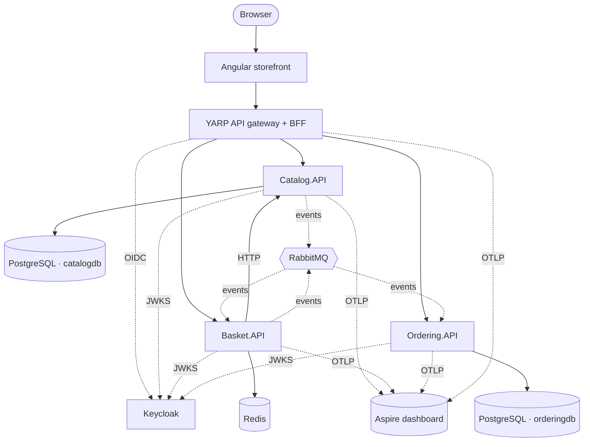
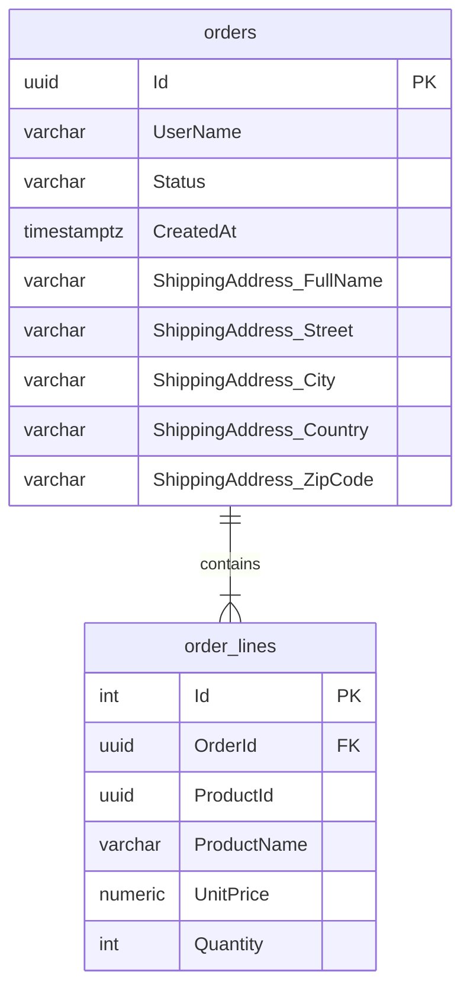
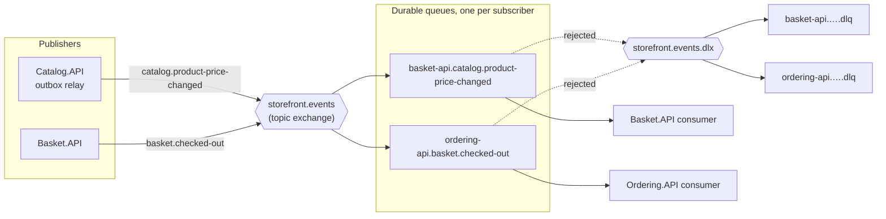
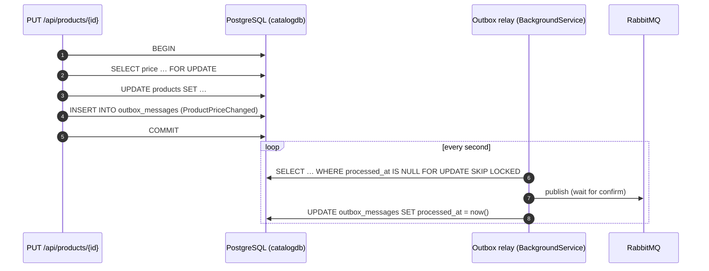
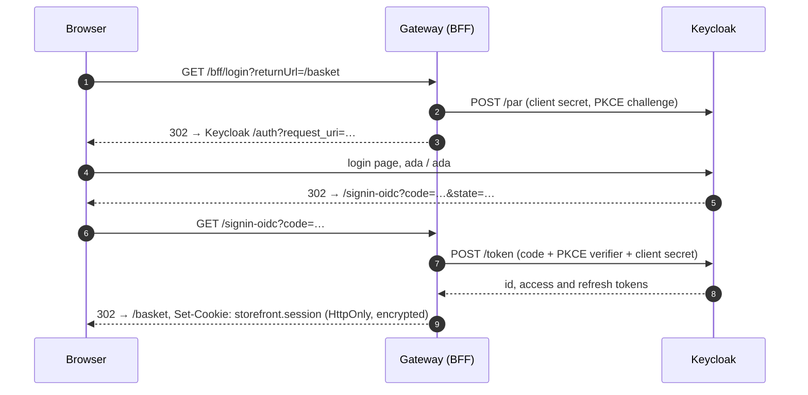
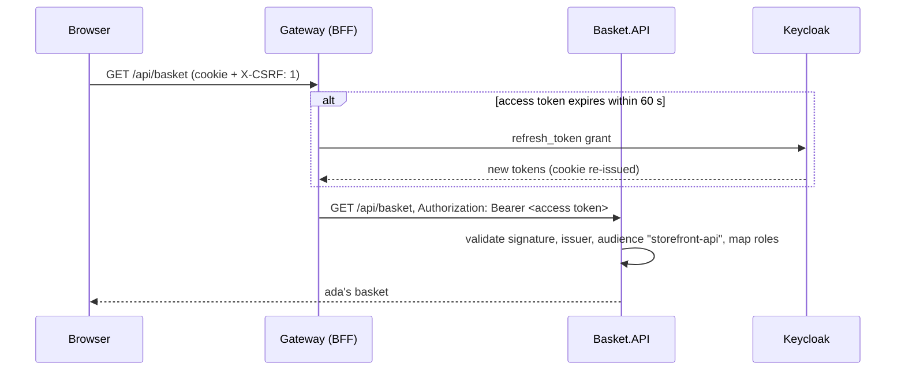
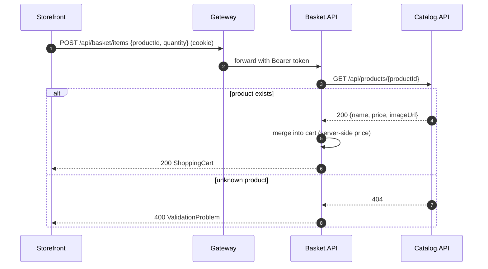
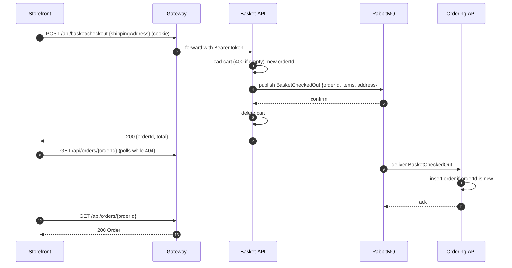

# Architecture

This document explains how the system is put together and why. For setup instructions see [getting-started.md](getting-started.md).

- [System context](#system-context)
- [Services](#services)
- [Communication](#communication)
- [Persistence](#persistence)
- [Messaging](#messaging)
- [Security](#security)
- [Request flows](#request-flows)
- [Cross-cutting concerns](#cross-cutting-concerns)
- [Design decisions](#design-decisions)
- [Testing strategy](#testing-strategy)
- [Known limitations](#known-limitations)

---

## System context



The browser only ever talks to **one origin**. In development the Angular dev server proxies `/api`, `/bff` and the OIDC callback paths to the gateway; in containers nginx does the same. That keeps the session cookie first-party. No service needs CORS, and the internal topology can change without touching the front end.

## Services

Every service is an ASP.NET Core **Minimal API** with the same internal layout:

```text
Service.API/
├── Program.cs        # composition root: AddServiceDefaults(), DI, MapDefaultEndpoints()
├── Endpoints/        # route groups (MapGroup) returning TypedResults
├── Models/           # immutable records: entities + request/response contracts
├── Data/             # repository interface, in-memory + database implementations,
│                     # DbContext and EF Core Migrations/ (Catalog, Ordering)
└── *ApiMarker.cs     # anchor type for WebApplicationFactory in tests
```

### Catalog.API

The source of truth for products and prices.

- **PostgreSQL** (`catalogdb`) through EF Core 10 + Npgsql
- Paged listing with category filter and free-text search (`PagedResult<T>` from BuildingBlocks); filtering, counting and paging all run in SQL
- Case-insensitive search with PostgreSQL `ILIKE`, escaping `%` and `_` so input is matched literally
- Updates and deletes use `ExecuteUpdateAsync` / `ExecuteDeleteAsync`: a single SQL statement, no load-then-save round trip
- Full CRUD with DataAnnotations validation on `UpsertProductRequest`
- Seeded with 8 products across 4 categories through EF Core's `UseAsyncSeeding`, which runs as part of `MigrateAsync()`

### Basket.API

A per-user shopping cart and the **orchestrator of checkout**.

- **Redis**: each cart is one JSON document under `basket:{user}` with a **sliding 30-day expiry** that every write renews, so abandoned carts clean themselves up
- The cart belongs to the signed-in user (keyed by their user name from the token); `ShoppingCart` and `CartItem` are immutable records updated with `with` expressions
- **Adding an item resolves the product from Catalog**, so a client can never set its own price
- **Checkout** sends the cart to Ordering, and clears the basket only after Ordering confirms
- Talks to other services through typed clients (`ICatalogClient`, `IOrderingClient`). That keeps HTTP details out of the endpoints and makes them easy to fake in tests

### Ordering.API

Owns orders and their lifecycle.

- **PostgreSQL** (`orderingdb`) through EF Core 10 + Npgsql
- The API's immutable `Order` record is **not** the EF entity; see [Persistence](#persistence)
- `OrderStatus` is serialized as a string (`JsonStringEnumConverter<T>`) and stored as a string column
- Uses `TimeProvider` instead of `DateTime.UtcNow`, so timestamps are deterministic in tests
- Writes a structured log entry for every order (`{OrderId}`, `{UserName}`, `{Total}`)

### ApiGateway

A [YARP](https://microsoft.github.io/reverse-proxy/) reverse proxy that is also the **backend-for-frontend (BFF)**: it signs users in with Keycloak and attaches their access token to proxied calls (see [Security](#security)). Routes come entirely from `appsettings.json`:

| Route | Cluster | Default destination |
|---|---|---|
| `/api/products/{**catch-all}` | `catalog` | `http://localhost:5101` |
| `/api/basket/{**catch-all}` | `basket` | `http://localhost:5102` |
| `/api/orders/{**catch-all}` | `ordering` | `http://localhost:5103` |

Destinations are overridden by environment variables under Aspire and Docker Compose. That is the only thing that differs between environments.

### BuildingBlocks.Common

A shared library that keeps every service consistent with two calls:

```csharp
builder.AddServiceDefaults();   // OpenAPI, ProblemDetails, health checks, resilience, OpenTelemetry
app.MapDefaultEndpoints();      // exception handler, /openapi, /scalar, /health
```

It deliberately holds **only cross-cutting infrastructure**, never domain types. Sharing domain models across services would couple their release cycles.

### AppHost (.NET Aspire)

Describes the whole system as code: which projects run, how they find each other and in what order they start. See [getting-started.md](getting-started.md#1-net-aspire-apphost).

## Communication

| From → To | Style | Why |
|---|---|---|
| Browser → Gateway | REST/JSON over HTTP | Simple, cacheable, debuggable |
| Gateway → Services | Reverse proxy | Path-based routing; services stay private |
| Basket → Catalog | Synchronous HTTP (query) | The price must be current when an item is added |
| Catalog → Basket | `ProductPriceChanged` event over RabbitMQ | Catalog shouldn't know who caches its prices; Basket reacts on its own schedule |
| Basket → Ordering | `BasketCheckedOut` event over RabbitMQ (HTTP fallback without a broker) | Checkout mustn't depend on Ordering being up; the order ID is generated up front |

All outgoing `HttpClient`s get the **standard resilience pipeline** from `Microsoft.Extensions.Http.Resilience`: rate limiter, total timeout, retry with exponential backoff and jitter, circuit breaker and per-attempt timeout. A brief Catalog hiccup becomes a retry, not a failed request.

## Persistence

Each service owns its data store, and no service reads another's database (*database per service*). The stores are chosen to fit their data:

| Service | Store | Why |
|---|---|---|
| Catalog | PostgreSQL `catalogdb` | Relational, queried by category and text, needs paging and consistency |
| Ordering | PostgreSQL `orderingdb` | Durable business records; orders and lines are naturally relational |
| Basket | Redis | Short-lived, per-user key-value data read and written on every click; expiry built in |

### Choosing the store at startup

```csharp
var usePostgres = builder.Configuration.GetConnectionString("catalogdb") is not null;
if (usePostgres)
{
    builder.AddNpgsqlDbContext<CatalogDbContext>("catalogdb", ...);   // Aspire client integration
    builder.Services.AddScoped<IProductRepository, EfProductRepository>();
}
else
{
    builder.Services.AddSingleton<IProductRepository, InMemoryProductRepository>();
}
```

Aspire (`WithReference(catalogDb)`) and Docker Compose set `ConnectionStrings__catalogdb`, so the real database is used. Plain `dotnet run` and the fast API tests set nothing and stay in memory. The endpoints only see `IProductRepository` and are unaware of the difference.

The Aspire client integrations (`Aspire.Npgsql.EntityFrameworkCore.PostgreSQL`, `Aspire.StackExchange.Redis`) add **DbContext pooling, transient-fault retries, health checks** (reported on `/health`) and **OpenTelemetry tracing** of every SQL command and Redis call.

### Schema and migrations

- The schema is defined in `OnModelCreating` (lengths, `numeric(18,2)` precision, indexes) and versioned as **EF Core migrations** in `Data/Migrations/`.
- Services apply pending migrations at startup with `Database.MigrateAsync()`. That is convenient for a demo; in production you would run them as a deployment step (`dotnet ef database update`, a migration bundle or an Aspire/Kubernetes job) so several replicas never race.
- An `IDesignTimeDbContextFactory` lets `dotnet ef` build each context without starting the app or reaching a database.

### Ordering's persistence model



The public `Order` / `OrderItem` / `ShippingAddress` records stay immutable and free of persistence concerns. EF works with internal `OrderEntity` / `OrderLineEntity` classes and maps to and from the records at the repository boundary. The shipping address is an EF **complex type**: a value object stored as columns on `orders`, with no table or key of its own. Order lines have their own identity key, so the same product may legitimately appear twice.

## Messaging

Integration events go through **RabbitMQ** using the official **RabbitMQ.Client 7** async API, wrapped in `BuildingBlocks.Messaging`. Like the databases, messaging switches on when `ConnectionStrings:rabbitmq` is set.

### Topology



- **One topic exchange**; the routing key is the event's stable name from `[EventName("…")]`.
- **Each subscribing service owns a durable queue** named `<service>.<event>`. Adding a new subscriber never affects existing ones, and a service that is down simply accumulates messages.
- **Dead-lettering:** each queue has an `x-dead-letter-exchange`. A message whose handler still fails after 3 in-process retries (200 ms, 1 s, 3 s), or that can't be deserialized, is rejected into `<queue>.dlq` for inspection instead of blocking the queue.
- **Events are owned per service.** Catalog, Basket and Ordering each declare their own copy of the records they publish or consume; only the JSON shape and the name must match. Services share no assembly with event types.

### Reliability guarantees

| Concern | How |
|---|---|
| Message survives a broker restart | Durable exchange and queues, `DeliveryMode = Persistent` |
| Publisher knows the broker has it | **Publisher confirms**: `PublishAsync` completes only after the broker's ack and throws on a nack |
| Event is never lost or sent for a rolled-back change | **Transactional outbox** (Catalog) |
| Consumer crash doesn't lose a message | Manual acks after the handler succeeds; unacked messages are redelivered |
| Redelivery doesn't duplicate side effects | **Idempotent consumers**: Ordering keys orders by the event's `OrderId`; repricing is naturally idempotent |
| One trace across services | W3C `traceparent` is injected into message headers on publish and extracted on consume (including from the outbox, which stores it) |

### Transactional outbox



Publishing directly after `SaveChanges` would fail in one of two ways: a crash in between loses the event, and publishing first could announce a change that then rolls back. The outbox makes the event part of the same atomic write. `FOR UPDATE SKIP LOCKED` lets several Catalog replicas run the relay without publishing the same row twice. Delivery is still *at-least-once* (a crash after publish but before marking the row re-sends it), which is why consumers are idempotent.

### Asynchronous checkout

Basket has no relational database, so instead of an outbox it relies on **publisher confirms**:

1. Generate the `OrderId`.
2. Publish `BasketCheckedOut` and wait for the broker's confirmation. If that fails, the request fails and the basket is untouched.
3. Delete the basket and return `{ orderId, total }`.

Ordering consumes the event and inserts the order **only if that ID doesn't exist yet**: an existence check plus a unique-key violation guard for concurrent deliveries. The storefront navigates to `/orders/{id}?placed=true` and shows a "processing" state, polling until the order appears (usually well under a second).

## Security

Authentication uses **Keycloak** (OpenID Connect) with the **backend-for-frontend** pattern. This is the approach recommended by the IETF's *OAuth 2.0 for Browser-Based Applications* best practice, because no token is ever exposed to JavaScript.

### Sign-in



- The gateway is a **confidential client** (`storefront-bff`). It uses the authorization code flow with **PKCE**, and **PAR** (pushed authorization requests, automatic in .NET 9+ when the provider supports it).
- Tokens are saved in the authentication ticket inside an **encrypted, HttpOnly, SameSite=Lax** cookie (chunked when large). Lax rather than Strict, because the cookie must be sent on the top-level redirect back from Keycloak.
- The gateway asks for **`response_mode=query`**, so Keycloak returns the code with a top-level GET redirect instead of ASP.NET's default cross-site form POST. That lets the OIDC correlation and nonce cookies be **Lax / SameAsRequest**. The framework default (`SameSite=None; Secure`) is dropped over plain HTTP and breaks local sign-in with "Correlation failed", while Lax cookies would not be sent on a cross-site POST. The code in the URL is single-use and bound to the PKCE verifier.
- `/bff/login` only accepts **local** return URLs, so it can't be used as an open redirect.
- `/bff/logout` clears the cookie **and** ends the Keycloak SSO session (front-channel logout with `id_token_hint`).

### Calling APIs



- **Token relay:** a YARP request transform replaces the cookie with the user's access token. Requests that arrive with their own `Authorization` header (API clients, curl) pass through unchanged.
- **Refresh:** Keycloak access tokens live 5 minutes. The cookie's `OnValidatePrincipal` refreshes them shortly before expiry and re-issues the cookie; if Keycloak refuses (session revoked, refresh token expired) the session ends and the next API call returns `401`.
- **CSRF:** the gateway rejects cookie-authenticated `/api` requests that lack an `X-CSRF` header. A cross-site form or link can't add custom headers, and cross-origin scripts would need a CORS preflight that is never granted. The Angular interceptor adds the header.

### Authorization in the services

Each service validates the JWT itself (defense in depth: a service is never trusted just because a request came through the gateway):

| Check | How |
|---|---|
| Signature and issuer | Keys and issuer from the realm's discovery document (`Identity:Authority`, optional `Identity:MetadataAddress`) |
| Audience | Must contain `storefront-api`; a Keycloak **audience mapper** on the clients adds it |
| Identity | `preferred_username` becomes `User.Identity.Name`; inbound claim mapping is off, so claim names stay as Keycloak issued them |
| Roles | Keycloak's `realm_access.roles` are expanded into role claims, so `RequireRole("admin")` works |

| Endpoint | Rule |
|---|---|
| `GET /api/products/**` | public |
| `POST/PUT/DELETE /api/products/**` | policy `admin` |
| `/api/basket/**` | signed in; the basket is the token user's |
| `GET /api/orders` | signed in; the token user's orders |
| `GET /api/orders/{id}` | owner or `admin`, otherwise `404` (not `403`, so IDs can't be probed) |

When Basket falls back to calling Ordering over HTTP, a `ForwardAccessTokenHandler` relays the caller's bearer token, so Ordering creates the order for the same user. With RabbitMQ, the user name travels in the `BasketCheckedOut` event, published by a service that has already authenticated the user.

### Rate limiting

The gateway applies ASP.NET Core's built-in rate limiter before anything is proxied, so every service is protected in one place ([`RateLimiting.cs`](../src/ApiGateways/ApiGateway/RateLimiting.cs)).

| Limiter | Applies to | Partition | Default | Algorithm |
|---|---|---|---|---|
| Global, signed in | everything except `/health` | `user:{name}` | burst 200, then 100 per 10 s | token bucket |
| Global, anonymous | everything except `/health` | `ip:{client IP}` | burst 60, then 30 per 10 s | token bucket |
| `checkout` policy | `POST /api/basket/checkout` (YARP route metadata) | user or IP | 5 per minute | fixed window |
| `login` policy | `GET /bff/login` | user or IP | 10 per minute | fixed window |

- **Why token buckets for the global limit:** a single page load fires several API calls at once. A bucket absorbs that burst and then caps the sustained rate, where a plain fixed window would either reject page loads or allow floods.
- **Partitioning:** authentication runs before the limiter, so a signed-in user has one budget across devices and networks, and many users behind one corporate NAT don't share a single IP budget. The client IP comes from `X-Forwarded-For` (nginx, the dev proxy), because `UseForwardedHeaders` runs first.
- **Per-route policies live in configuration:** checkout is a separate YARP route (`basket-checkout`, with `"RateLimiterPolicy": "checkout"`). Literal paths win over the `{**catch-all}` route, so only checkout gets the stricter limit.
- **Rejections** return `429` with `Retry-After` and ProblemDetails (`"title": "Too many requests"`), and are logged with the partition. The storefront shows the message like any other API error.
- **Tuning** happens under `RateLimiting` in the gateway's configuration (`Anonymous`, `Authenticated`, `Checkout`, `Login`), e.g. `RateLimiting__Checkout__PermitLimit=10`.
- **Observability:** the `Microsoft.AspNetCore.RateLimiting` meter is exported through OpenTelemetry, so active leases and rejected requests appear in the Aspire dashboard's metrics.

### Output caching

Catalog reads are the hottest, least personal traffic, so the gateway answers repeats itself with ASP.NET Core output caching ([`OutputCaching.cs`](../src/ApiGateways/ApiGateway/OutputCaching.cs)).

- **Opt-in per route in configuration:** the `catalog` YARP route carries `"OutputCachePolicy": "catalog"`. Basket and ordering are per-user and never cached.
- **What is stored:** `GET` responses with status `200` and no `Set-Cookie`, for 60 seconds by default, keyed by path and the full query string (`?page=2&category=Books` is its own entry). Errors and `404`s always reach Catalog.
- **Shared across users:** the framework's default policy skips signed-in users. The catalog is the same for everyone, so this policy doesn't. A response that refreshes the session cookie is never stored, so one user's cookie can't be replayed to another.
- **Stampede protection:** concurrent misses for the same key wait for one downstream call instead of all hitting Catalog.
- **Invalidation:** the policy tags its entries with its own name. A YARP response transform evicts that tag after a successful `POST`/`PUT`/`PATCH`/`DELETE` through the same route, before the response returns, so an admin sees their change on the next read. Rejected writes (`4xx`/`5xx`) keep the cache.
- **Where it sits:** after the rate limiter and the CSRF check, so cache hits still count against a caller's budget and still need `X-CSRF`.
- **Limits:** the cache is in memory per gateway instance. Changes that bypass the gateway, or reach a different replica, show up when entries expire. Running several replicas would call for a shared store such as Redis (`AddStackExchangeRedisOutputCache`), which makes eviction cluster-wide.
- **Tuning:** `OutputCaching__CatalogSeconds=300`. Cached responses carry an `Age` header.

### Keycloak realm

[`deploy/keycloak/storefront-realm.json`](../deploy/keycloak/storefront-realm.json) is imported by Aspire (`WithRealmImport`), Docker Compose (`--import-realm`) and the Testcontainers tests:

- realm roles `admin` and `customer`, with `customer` granted to every new user via the default role;
- `storefront-bff`: confidential client, standard flow only, PKCE S256, redirect URIs for `localhost:4200` and `localhost:5100`;
- `storefront-tests`: public client with the password grant, used only by the automated tests;
- demo users `ada` (admin) and `grace` (customer).

### Container networking (docker-compose)

The browser reaches Keycloak at `localhost:8080`, containers reach it at `keycloak:8080`. Keycloak's hostname v2 options handle the split:

- `KC_HOSTNAME=http://localhost:8080`: tokens are issued by, and browsers are sent to, `localhost:8080`.
- `KC_HOSTNAME_BACKCHANNEL_DYNAMIC=true`: back-channel URLs (token, JWKS) follow the request host, so containers keep using `keycloak:8080`.
- Services use `Identity:Authority=http://localhost:8080/realms/storefront` (the issuer) and `Identity:MetadataAddress=http://keycloak:8080/…/.well-known/openid-configuration` (where to fetch it).

## Request flows

### Add to basket



### Checkout (with RabbitMQ)



Without a broker the same endpoint calls `POST /api/orders` on Ordering synchronously. The switch is a different `IOrderingClient` implementation registered at startup, so the endpoint code is identical in both modes.

Because OpenTelemetry propagates W3C trace context through the gateway, every `HttpClient` and every RabbitMQ message, these flows appear as **single end-to-end traces** in the Aspire dashboard.

## Cross-cutting concerns

| Concern | Implementation |
|---|---|
| **Validation** | .NET 10 built-in Minimal API validation (`AddValidation()`) on DataAnnotations; failures return `400 ValidationProblem` automatically |
| **Errors** | `AddProblemDetails()` + `UseExceptionHandler()` + `UseStatusCodePages()`: every error is RFC 9457 `application/problem+json` |
| **API docs** | `AddOpenApi()` generates the document at `/openapi/v1.json`; Scalar renders it at `/scalar` |
| **Health** | `/health` runs every check (readiness), `/alive` none (liveness), on every service and the gateway; Aspire uses `/health`, Kubernetes and Container Apps use both, so a dependency outage removes pods from rotation instead of restarting them |
| **Resilience** | `ConfigureHttpClientDefaults(h => h.AddStandardResilienceHandler())` |
| **Logging** | `ILogger` with message templates; exported through OpenTelemetry |
| **Tracing and metrics** | OpenTelemetry instrumentation for ASP.NET Core (excluding `/health`), HttpClient and the .NET runtime |
| **Export** | OTLP, enabled only when `OTEL_EXPORTER_OTLP_ENDPOINT` is set (Aspire and Compose set it; tests don't) |
| **Rate limiting** | Gateway-wide token buckets per user / IP, stricter checkout and sign-in policies, `429` + `Retry-After` |
| **Output caching** | Catalog reads cached at the gateway, shared across users, evicted on successful catalog writes |
| **Container security** | Chiseled images: no shell, no package manager, non-root user |
| **Deployment** | Kustomize manifests (kind in CI) and Azure Container Apps via `azd` + Bicep; see [deployment.md](deployment.md) |

## Design decisions

<details open>
<summary><b>Minimal APIs over controllers</b></summary>

Endpoints are small and explicit. `TypedResults` with `Results<T1, T2>` gives compile-time-checked responses and accurate OpenAPI metadata without attributes. Route groups (`MapGroup`) keep related endpoints together.
</details>

<details>
<summary><b>Records and immutability</b></summary>

Domain objects and contracts are `sealed record`s. Updates use `with` expressions (for example `cart with { Items = ... }`), which removes a class of shared-mutable-state bugs in concurrent in-memory stores.
</details>

<details>
<summary><b>Real databases, with an in-memory fallback</b></summary>

Endpoints depend only on `IProductRepository`, `IBasketRepository` and `IOrderRepository`. With a connection string they get PostgreSQL or Redis implementations; without one they get in-memory ones. The project stays clone-and-run (no Docker needed to try it), and the fast API tests stay fast, while the real stores are exercised by the Testcontainers suite.
</details>

<details>
<summary><b>EF Core for Postgres, plain StackExchange.Redis for baskets</b></summary>

Catalog and Ordering get EF Core's migrations, LINQ translation and change tracking. Basket uses Redis as what it is, a key-value store: one `GET` or `SET` per request with a TTL, so an ORM or `IDistributedCache` abstraction would add nothing.
</details>

<details>
<summary><b>The server owns prices</b></summary>

`AddItemRequest` carries only `productId` and `quantity`. Basket fetches the name and price from Catalog, which prevents price tampering from the client.
</details>

<details>
<summary><b>Asynchronous checkout with a client-generated order ID</b></summary>

The UI wants an order ID right away, which previously forced a synchronous call to Ordering. Generating the ID in Basket removes that coupling: Basket can answer as soon as the broker has the message, Ordering can be down or slow, and the ID doubles as the idempotency key. The cost is eventual consistency: the order shows up a moment later, which the UI handles with a short "processing" state.
</details>

<details>
<summary><b>RabbitMQ.Client instead of MassTransit</b></summary>

MassTransit v9 moved to a commercial license, and the open-source v8 line is nearing its end of support. The official client plus a building block of under 500 lines (publisher confirms, consumer host with retries and DLQ, outbox, tracing) keeps the project free of licensing questions, and every pattern stays visible in the source. A team that wants sagas, scheduling or transport abstraction would reasonably choose MassTransit, Wolverine or NServiceBus instead.
</details>

<details>
<summary><b>Outbox for Catalog, publisher confirms for Basket</b></summary>

An outbox needs a transactional store next to the business data. Catalog has PostgreSQL, so its events are written atomically with the change. Basket keeps carts in Redis, so it publishes directly and only deletes the cart after the broker confirms; a failure leaves the cart intact and the user can retry.
</details>

<details>
<summary><b>BFF instead of tokens in the SPA</b></summary>

A browser-based OIDC client (PKCE in Angular) would keep access and refresh tokens in JavaScript-reachable storage, so any XSS bug could steal them. With the gateway as BFF, the browser holds only an HttpOnly cookie, and the gateway can refresh tokens with a client secret. The Angular app also needs no OIDC library. The costs are a stateful gateway session and CSRF protection, both handled in a few dozen lines.
</details>

<details>
<summary><b>Services validate tokens even behind the gateway</b></summary>

Zero trust between hops: a misrouted request, a new internal caller or a compromised neighbour can't act as a user without a valid, correctly-scoped token. Each check is local (cached signing keys), so it costs almost nothing.
</details>

<details>
<summary><b>Each service owns its contracts</b></summary>

`ShippingAddress` exists in both Basket and Ordering. The duplication is deliberate: each service can evolve its contract independently, as long as the JSON stays compatible.
</details>

<details>
<summary><b>A gateway instead of direct calls from the browser</b></summary>

One origin means no CORS, a first-party session cookie, a single place for sign-in, rate limiting and caching, and freedom to split or merge services without front-end changes.
</details>

## Testing strategy

| Layer | Tooling | What is verified |
|---|---|---|
| Service API | xUnit v3, `WebApplicationFactory<TMarker>` (in-memory stores) | Real HTTP pipeline: routing, validation, status codes, JSON contracts |
| Service isolation | `ConfigureTestServices` with fake typed clients | Basket logic without running Catalog or Ordering |
| Persistence | Testcontainers (PostgreSQL 18, Redis 8) | Migrations and seeding, SQL filtering and paging, `ILIKE` escaping, data surviving an app restart, Redis TTL and case-insensitive keys |
| Gateway rate limiting | `WebApplicationFactory` with tiny limits from configuration | `429` with `Retry-After` and ProblemDetails, separate budgets per client IP, `/health` exempt, checkout's stricter route policy, user vs IP partition keys |
| Gateway output caching | `WebApplicationFactory` with a counting fake `IForwarderHttpClientFactory` | Repeat reads served without a downstream call (`Age` header), one entry per query string, `404`s and uncached routes always proxied, eviction after a successful write but not after a rejected one |
| Authorization rules | Test authentication handler (`X-Test-User` / `X-Test-Roles`) | 401 for anonymous calls, 403 for non-admins, per-user basket and order isolation, admin access to any order |
| Real tokens | Testcontainers (Keycloak 26 with the project realm) | Signature, issuer and audience validation, realm-role mapping (admin vs customer), tampered tokens rejected |
| BFF sign-in (end to end) | Keycloak container + the real gateway + an echo backend | `/bff/login` → Keycloak login form → `/signin-oidc` → HttpOnly session → `/bff/user` roles → access token relayed with the right audience → logout ends the SSO session |
| Service contracts | PactNet 5: consumer tests against Pact mocks, provider verification on Kestrel | Basket's real `CatalogClient`, `OrderingClient` (with token relay) and price-change handler, Ordering's checkout handler; the real Catalog, Ordering and Basket honour every committed pact (see [Contract tests](#contract-tests)) |
| Messaging (end to end) | Testcontainers (RabbitMQ 4) with two live services per test | Catalog price change → outbox → relay → Basket reprices the Redis cart; Basket checkout → RabbitMQ → order in Ordering's PostgreSQL; a duplicated message creates one order; unchanged prices stage no event |
| Front-end state | Vitest, `HttpTestingController` | `BasketStore` URLs, payloads and state transitions |
| Front-end components | Angular TestBed | Rendering, query-param binding, form validation, error states |
| End to end | Playwright (Chromium) against the Docker Compose stack, and again against a kind cluster | Real Keycloak sign-in and sign-out (including the SSO session), catalog filters in the URL, basket badge and totals, checkout validation, an order placed through RabbitMQ and polled until Ordering has it, an admin price change shown at once (cache eviction) and repricing an open basket via the outbox |
| Containers | GitHub Actions `docker compose build` | Every image builds from a clean checkout |

### Contract tests

Services share no contract assemblies: each declares its own copy of the DTOs and events it exchanges ([Messaging](#messaging)). That keeps them independently deployable, but the compiler can no longer catch a renamed field. The consumer-driven contracts in `tests/Services.ContractTests` restore that safety net.

| Consumer | Provider (pact name) | Interactions |
|---|---|---|
| Basket.API | Catalog.API | `GET /api/products/{id}` → `id`, `name`, `imageUrl`, `price`; unknown id → `404` |
| Basket.API | Ordering.API | `POST /api/orders` with `Authorization: Bearer …` → `201` with `id`, `total` |
| Basket.API | Catalog.API.Events | `catalog.product-price-changed` |
| Ordering.API | Basket.API.Events | `basket.checked-out` |

- **Consumers write the contract** by running their real code against a Pact mock: Basket's typed clients (including `ForwardAccessTokenHandler`) and its price-change handler, and Ordering's checkout handler. Only the fields a consumer reads go into the pact, with type and regex matchers rather than exact values, so providers can add fields freely.
- **Providers verify it** against the real service, started by `WebApplicationFactory` on a free Kestrel port with its in-memory store. A provider-state endpoint seeds the data an interaction assumes (`a product exists`), and a test scheme accepts any bearer token; token validation is covered by the Keycloak tests.
- **Events** use separate pact names (`*.Events`) because a Pact verifier checks either HTTP or messages. Each provider host serves its events over HTTP, built by real code (Basket's goes through `MessagingOrderingClient`) and serialized with the bus's JSON settings. PactNet 5.0.1's own message transport is avoided because the verifier rejects its `message://` URL.
- **No broker:** with every service in one repository, the pact files are committed under `tests/Services.ContractTests/pacts/`. Consumer tests regenerate them, provider tests verify the committed copies, and CI fails if a run leaves them changed, so a contract change always shows up in a diff for review. Splitting the services into separate repositories would mean publishing pacts to a Pact Broker and running `can-i-deploy`.

## Known limitations

These are intentional simplifications for a demo:

- **Development secrets in the realm file.** The BFF client secret and demo passwords are committed for local use; production would inject them and drop the `storefront-tests` client.
- **Rate-limit counters are per gateway instance** (in memory). With several replicas each enforces its own budget, so the effective limit multiplies. A distributed limiter (for example Redis-backed) or limits at the load balancer would fix this.
- **`X-Forwarded-For` is trusted from any source by default** (one hop, no known-proxy list), so a client that reaches the gateway directly could rotate IPs to dodge anonymous limits. Setting `ForwardedHeaders:KnownNetworks` to the proxies' range (as the Azure deployment does) trusts only them and unwinds a multi-proxy chain to the real client.
- **Gateway session keys aren't shared.** ASP.NET Core data protection keys live in the container, so restarting or scaling the gateway signs users out. Persist them (Redis, a volume or a key vault) to fix this.
- **Data is keyed by user name**, not the stable `sub` claim. Keycloak lets admins rename users, which would orphan their baskets and orders.
- **Logout is a GET**, so a malicious page could sign a user out (logout CSRF). This is low impact, but a POST with an antiforgery token would remove it.
- **Migrations run at startup.** That is fine for one replica; with several, run migrations as a separate deployment step.
- **Basket updates are last-write-wins.** Two simultaneous "add item" requests for the same user can overwrite each other. Redis transactions (`WATCH`/`MULTI`) or a hash per basket would fix this.
- **In-memory fallback** (when no connection string is set) loses data on restart and must not be scaled out.
- **Basket publish-then-delete isn't atomic.** If Basket crashes after the broker confirms but before the cart is deleted, the order is still created; the cart just stays around until the user clears it.
- **No dead-letter tooling.** Failed messages land in `<queue>.dlq`, but replaying them means using the RabbitMQ management UI.
- **The outbox is never pruned.** Processed rows stay in `outbox_messages`; production would delete them after a retention period.
- **HTTP checkout fallback (no broker)** keeps the old trade-off: if Ordering's response is lost, a retry could create a second order.
- **Product deletion** does not affect existing baskets; they keep a snapshot of name and price.
