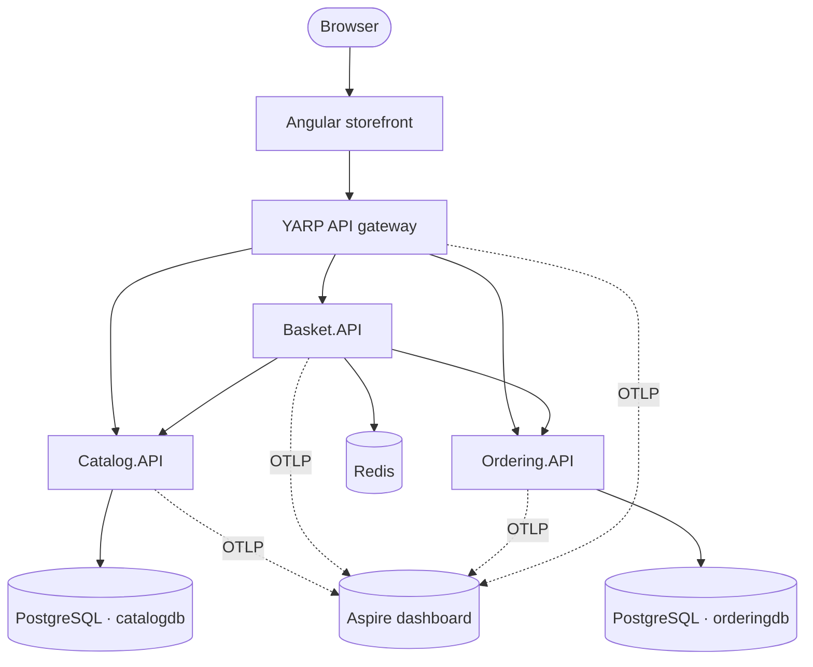
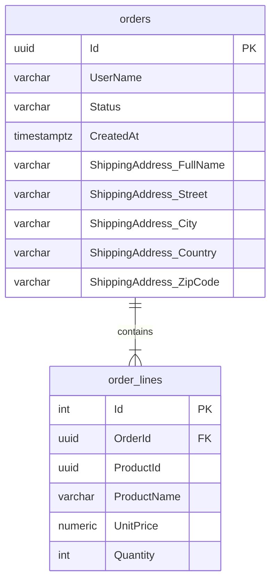
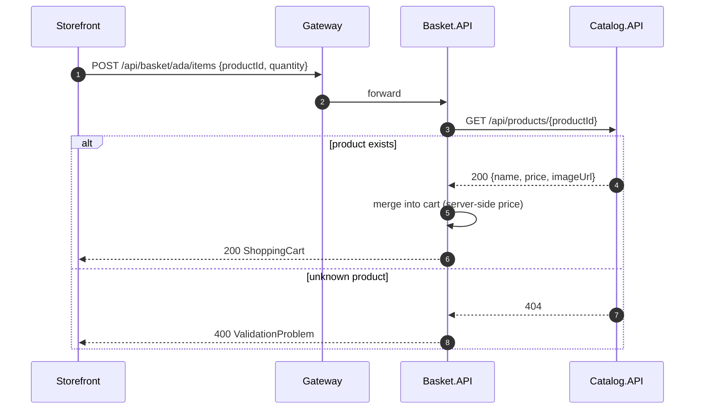
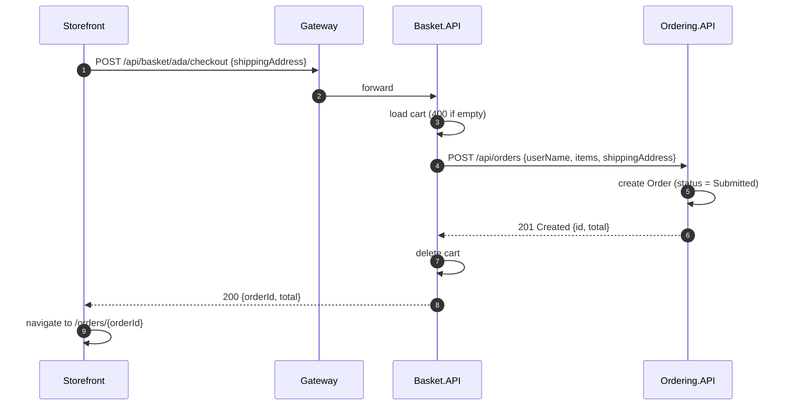

# Architecture

This document explains how the system is put together and why. For setup instructions see [getting-started.md](getting-started.md).

- [System context](#system-context)
- [Services](#services)
- [Communication](#communication)
- [Persistence](#persistence)
- [Request flows](#request-flows)
- [Cross-cutting concerns](#cross-cutting-concerns)
- [Design decisions](#design-decisions)
- [Testing strategy](#testing-strategy)
- [Known limitations](#known-limitations)

---

## System context



The browser only ever talks to **one origin**. In development the Angular dev server proxies `/api` to the gateway; in containers nginx does the same. No service needs CORS, and the internal topology can change without touching the front end.

## Services

Every service is an ASP.NET Core **Minimal API** with the same internal layout:

```text
Service.API/
├── Program.cs        # composition root: AddServiceDefaults(), DI, MapDefaultEndpoints()
├── Endpoints/        # route groups (MapGroup) returning TypedResults
├── Models/           # immutable records: entities + request/response contracts
├── Data/             # repository interface, in-memory + database implementations,
│                     # DbContext and EF Core Migrations/ (Catalog, Ordering)
└── *ApiMarker.cs     # anchor type for WebApplicationFactory in tests
```

### Catalog.API

The source of truth for products and prices.

- **PostgreSQL** (`catalogdb`) through EF Core 10 + Npgsql
- Paged listing with category filter and free-text search (`PagedResult<T>` from BuildingBlocks); filtering, counting and paging all run in SQL
- Case-insensitive search with PostgreSQL `ILIKE`, escaping `%` and `_` so input is matched literally
- Updates and deletes use `ExecuteUpdateAsync` / `ExecuteDeleteAsync`: a single SQL statement, no load-then-save round trip
- Full CRUD with DataAnnotations validation on `UpsertProductRequest`
- Seeded with 8 products across 4 categories through EF Core's `UseAsyncSeeding`, which runs as part of `MigrateAsync()`

### Basket.API

A per-user shopping cart and the **orchestrator of checkout**.

- **Redis**: each cart is one JSON document under `basket:{user}` with a **sliding 30-day expiry** that every write renews, so abandoned carts clean themselves up
- The cart is keyed by user name; `ShoppingCart` and `CartItem` are immutable records updated with `with` expressions
- **Adding an item resolves the product from Catalog**, so a client can never set its own price
- **Checkout** sends the cart to Ordering, and clears the basket only after Ordering confirms
- Talks to other services through typed clients (`ICatalogClient`, `IOrderingClient`). That keeps HTTP details out of the endpoints and makes them easy to fake in tests

### Ordering.API

Owns orders and their lifecycle.

- **PostgreSQL** (`orderingdb`) through EF Core 10 + Npgsql
- The API's immutable `Order` record is **not** the EF entity; see [Persistence](#persistence)
- `OrderStatus` is serialized as a string (`JsonStringEnumConverter<T>`) and stored as a string column
- Uses `TimeProvider` instead of `DateTime.UtcNow`, so timestamps are deterministic in tests
- Writes a structured log entry for every order (`{OrderId}`, `{UserName}`, `{Total}`)

### ApiGateway

A [YARP](https://microsoft.github.io/reverse-proxy/) reverse proxy configured entirely from `appsettings.json`:

| Route | Cluster | Default destination |
|---|---|---|
| `/api/products/{**catch-all}` | `catalog` | `http://localhost:5101` |
| `/api/basket/{**catch-all}` | `basket` | `http://localhost:5102` |
| `/api/orders/{**catch-all}` | `ordering` | `http://localhost:5103` |

Destinations are overridden by environment variables under Aspire and Docker Compose. That is the only thing that differs between environments.

### BuildingBlocks.Common

A shared library that keeps every service consistent with two calls:

```csharp
builder.AddServiceDefaults();   // OpenAPI, ProblemDetails, health checks, resilience, OpenTelemetry
app.MapDefaultEndpoints();      // exception handler, /openapi, /scalar, /health
```

It deliberately holds **only cross-cutting infrastructure**, never domain types. Sharing domain models across services would couple their release cycles.

### AppHost (.NET Aspire)

Describes the whole system as code: which projects run, how they find each other and in what order they start. See [getting-started.md](getting-started.md#1-net-aspire-apphost).

## Communication

| From → To | Style | Why |
|---|---|---|
| Browser → Gateway | REST/JSON over HTTP | Simple, cacheable, debuggable |
| Gateway → Services | Reverse proxy | Path-based routing; services stay private |
| Basket → Catalog | Synchronous HTTP (query) | The price must be current when an item is added |
| Basket → Ordering | Synchronous HTTP (command) | The user expects an order ID immediately after checkout |

All outgoing `HttpClient`s get the **standard resilience pipeline** from `Microsoft.Extensions.Http.Resilience`: rate limiter, total timeout, retry with exponential backoff and jitter, circuit breaker and per-attempt timeout. A brief Catalog hiccup becomes a retry, not a failed request.

## Persistence

Each service owns its data store, and no service reads another's database (*database per service*). The stores are chosen to fit their data:

| Service | Store | Why |
|---|---|---|
| Catalog | PostgreSQL `catalogdb` | Relational, queried by category and text, needs paging and consistency |
| Ordering | PostgreSQL `orderingdb` | Durable business records; orders and lines are naturally relational |
| Basket | Redis | Short-lived, per-user key-value data read and written on every click; expiry built in |

### Choosing the store at startup

```csharp
var usePostgres = builder.Configuration.GetConnectionString("catalogdb") is not null;
if (usePostgres)
{
    builder.AddNpgsqlDbContext<CatalogDbContext>("catalogdb", ...);   // Aspire client integration
    builder.Services.AddScoped<IProductRepository, EfProductRepository>();
}
else
{
    builder.Services.AddSingleton<IProductRepository, InMemoryProductRepository>();
}
```

Aspire (`WithReference(catalogDb)`) and Docker Compose set `ConnectionStrings__catalogdb`, so the real database is used. Plain `dotnet run` and the fast API tests set nothing and stay in memory. The endpoints only see `IProductRepository` and are unaware of the difference.

The Aspire client integrations (`Aspire.Npgsql.EntityFrameworkCore.PostgreSQL`, `Aspire.StackExchange.Redis`) add **DbContext pooling, transient-fault retries, health checks** (reported on `/health`) and **OpenTelemetry tracing** of every SQL command and Redis call.

### Schema and migrations

- The schema is defined in `OnModelCreating` (lengths, `numeric(18,2)` precision, indexes) and versioned as **EF Core migrations** in `Data/Migrations/`.
- Services apply pending migrations at startup with `Database.MigrateAsync()`. That is convenient for a demo; in production you would run them as a deployment step (`dotnet ef database update`, a migration bundle or an Aspire/Kubernetes job) so several replicas never race.
- An `IDesignTimeDbContextFactory` lets `dotnet ef` build each context without starting the app or reaching a database.

### Ordering's persistence model



The public `Order` / `OrderItem` / `ShippingAddress` records stay immutable and free of persistence concerns. EF works with internal `OrderEntity` / `OrderLineEntity` classes and maps to and from the records at the repository boundary. The shipping address is an EF **complex type**: a value object stored as columns on `orders`, with no table or key of its own. Order lines have their own identity key, so the same product may legitimately appear twice.

## Request flows

### Add to basket



### Checkout



Because OpenTelemetry propagates W3C trace context through the gateway and every `HttpClient`, these flows appear as **single end-to-end traces** in the Aspire dashboard.

## Cross-cutting concerns

| Concern | Implementation |
|---|---|
| **Validation** | .NET 10 built-in Minimal API validation (`AddValidation()`) on DataAnnotations; failures return `400 ValidationProblem` automatically |
| **Errors** | `AddProblemDetails()` + `UseExceptionHandler()` + `UseStatusCodePages()`: every error is RFC 9457 `application/problem+json` |
| **API docs** | `AddOpenApi()` generates the document at `/openapi/v1.json`; Scalar renders it at `/scalar` |
| **Health** | `/health` on every service and the gateway, used by Aspire `WithHttpHealthCheck` |
| **Resilience** | `ConfigureHttpClientDefaults(h => h.AddStandardResilienceHandler())` |
| **Logging** | `ILogger` with message templates; exported through OpenTelemetry |
| **Tracing and metrics** | OpenTelemetry instrumentation for ASP.NET Core (excluding `/health`), HttpClient and the .NET runtime |
| **Export** | OTLP, enabled only when `OTEL_EXPORTER_OTLP_ENDPOINT` is set (Aspire and Compose set it; tests don't) |
| **Container security** | Chiseled images: no shell, no package manager, non-root user |

## Design decisions

<details open>
<summary><b>Minimal APIs over controllers</b></summary>

Endpoints are small and explicit. `TypedResults` with `Results<T1, T2>` gives compile-time-checked responses and accurate OpenAPI metadata without attributes. Route groups (`MapGroup`) keep related endpoints together.
</details>

<details>
<summary><b>Records and immutability</b></summary>

Domain objects and contracts are `sealed record`s. Updates use `with` expressions (for example `cart with { Items = ... }`), which removes a class of shared-mutable-state bugs in concurrent in-memory stores.
</details>

<details>
<summary><b>Real databases, with an in-memory fallback</b></summary>

Endpoints depend only on `IProductRepository`, `IBasketRepository` and `IOrderRepository`. With a connection string they get PostgreSQL or Redis implementations; without one they get in-memory ones. The project stays clone-and-run (no Docker needed to try it), and the fast API tests stay fast, while the real stores are exercised by the Testcontainers suite.
</details>

<details>
<summary><b>EF Core for Postgres, plain StackExchange.Redis for baskets</b></summary>

Catalog and Ordering get EF Core's migrations, LINQ translation and change tracking. Basket uses Redis as what it is, a key-value store: one `GET` or `SET` per request with a TTL, so an ORM or `IDistributedCache` abstraction would add nothing.
</details>

<details>
<summary><b>The server owns prices</b></summary>

`AddItemRequest` carries only `productId` and `quantity`. Basket fetches the name and price from Catalog, which prevents price tampering from the client.
</details>

<details>
<summary><b>Synchronous checkout (for now)</b></summary>

Checkout calls Ordering synchronously because the UI needs an order ID right away, and it keeps the demo easy to follow. The trade-off: if Ordering is down, checkout fails (after retries). The roadmap moves to an asynchronous `BasketCheckedOut` event with an outbox for at-least-once delivery.
</details>

<details>
<summary><b>Each service owns its contracts</b></summary>

`ShippingAddress` exists in both Basket and Ordering. The duplication is deliberate: each service can evolve its contract independently, as long as the JSON stays compatible.
</details>

<details>
<summary><b>A gateway instead of direct calls from the browser</b></summary>

One origin means no CORS, a single place for future auth, rate limiting and caching, and freedom to split or merge services without front-end changes.
</details>

## Testing strategy

| Layer | Tooling | What is verified |
|---|---|---|
| Service API | xUnit v3, `WebApplicationFactory<TMarker>` (in-memory stores) | Real HTTP pipeline: routing, validation, status codes, JSON contracts |
| Service isolation | `ConfigureTestServices` with fake typed clients | Basket logic without running Catalog or Ordering |
| Persistence | Testcontainers (PostgreSQL 18, Redis 8) | Migrations and seeding, SQL filtering and paging, `ILIKE` escaping, data surviving an app restart, Redis TTL and case-insensitive keys |
| Front-end state | Vitest, `HttpTestingController` | `BasketStore` URLs, payloads and state transitions |
| Front-end components | Angular TestBed | Rendering, query-param binding, form validation, error states |
| Containers | GitHub Actions `docker compose build` | Every image builds from a clean checkout |

## Known limitations

These are intentional simplifications for a demo:

- **No authentication.** The "user" is a name stored in the browser. Never ship this as is.
- **Migrations run at startup.** That is fine for one replica; with several, run migrations as a separate deployment step.
- **Basket updates are last-write-wins.** Two simultaneous "add item" requests for the same user can overwrite each other. Redis transactions (`WATCH`/`MULTI`) or a hash per basket would fix this.
- **In-memory fallback** (when no connection string is set) loses data on restart and must not be scaled out.
- **No distributed transaction on checkout.** If Ordering succeeds but the response is lost, a retry could create a duplicate order. An idempotency key or the outbox pattern on the roadmap fixes this.
- **Product deletion** does not affect existing baskets; they keep a snapshot of name and price.
